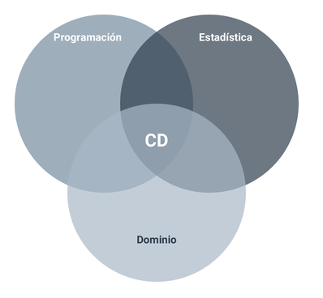
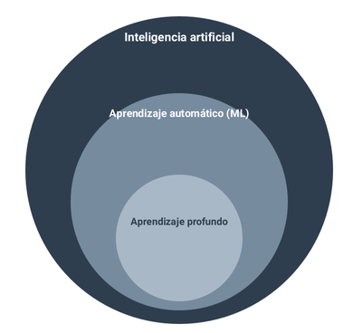
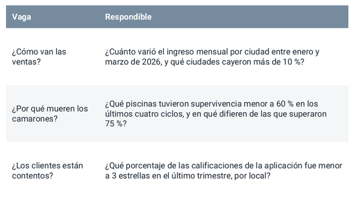
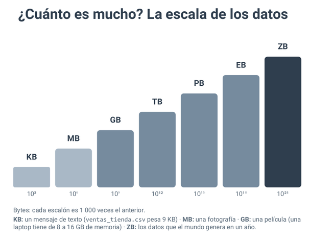
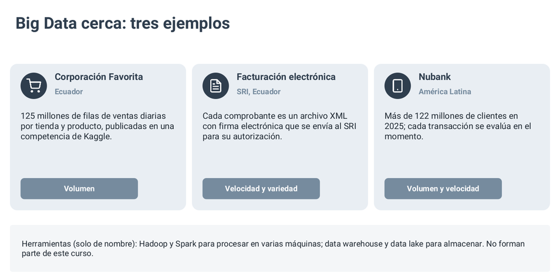
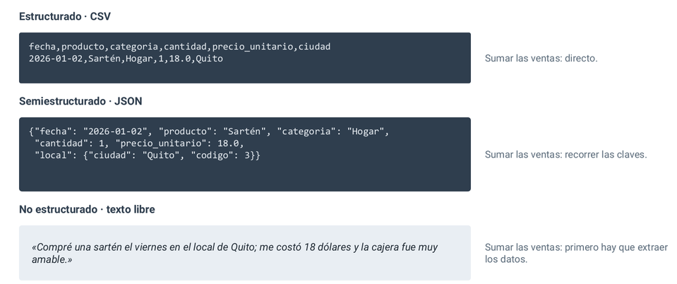
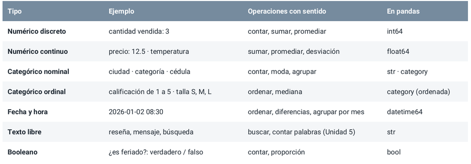

# Fundamentos de Ciencia de datos e Inteligencia Artificial

## ¿Qué es la ciencia de datos?

La ciencia de datos se define operativamente como **el proceso de obtener conclusiones** 
**útiles a partir de datos para respaldar una decisión**. Para que un proyecto sea exitoso, 
se requiere la intersección de **tres pilares indispensables**:



1. Programación: Es la herramienta que nos **permite automatizar tareas repetitivas y procesar volúmenes de**
**datos que sería imposible analizar manualmente**. Se usan librerías especializadas como pandas (Python).

2. Estadística: Nos permite saber si un hallazgo es estadísticamente **significativo o pura** 
**casualidad**, además de estimar cuánta confianza merece un resultado.

3. Conocimiento del Dominio: Sin conocimiento del área, no podemos hacer las preguntas correctas 
ni interpretar si las respuestas del modelo tienen sentido en la vida real.

> Si falta alguno de estos tres pilares, el resultado puede ser muy vistoso visualmente, pero completamente inútil o 
erróneo.

---

## ¿Qué es la Inteligencia Artificial?

La Inteligencia Artificial (IA) se define como **cualquier sistema capaz de realizar tareas que**
**normalmente asociamos con la inteligencia humana (reconocer patrones, predecir, recomendar o decidir)**.

Dentro de la IA **existen distintos niveles de complejidad**:



- IA basada en reglas fijas: Funciona mediante **lógica explícita** programada por un humano.

- Aprendizaje Automático (Machine Learning): El sistema no recibe las reglas escritas a mano, sino que 
**descubre la regla** o el patrón automáticamente a partir de ejemplos (datos).

- Aprendizaje Profundo: Es la tecnología detrás del reconocimiento de voz, visión por computador y 
los chatbots/modelos de lenguaje modernos.

Este curso se enfocará principalmente en **aprendizaje no supervisado** (técnicas como clustering) y tendrá 
una introducción conceptual al aprendizaje supervisado.

### ¿Cómo se relacionan estas disciplinas?

- **Ciencia de Datos**: Es el marco general. Plantea la pregunta, explora los datos, elige el método 
y comunica la respuesta final.

- **IA / Machine Learning**: Es una herramienta dentro de la Ciencia de Datos que aporta los métodos 
para agrupar, predecir o clasificar.

- **Estadística**: Es el fundamento matemático que nos dice qué es una media, una correlación o el margen de error.

- **Ingeniería de Datos**: Se encarga de construir las tuberías y la infraestructura (bases de datos, APIs, flujos) 
para que los datos lleguen limpios y disponibles.

- **El Negocio / Dominio**: Es quien plantea la necesidad inicial y toma la decisión. "Un análisis que no 
respalda una decisión es solo un ejercicio académico, no un proyecto". 

---

## La Jornada de un científico de datos

En encuestas a profesionales, el 80% del tiempo se dedica a obtener, limpiar y comprender los 
datos. Un resumen de lo que realizan los científicos de datos es:

1. Aclarar la pregunta con quien decide -> ¿Qué haría distinto si conociera la respuesta?

2. Obtener y limpiar datos -> Nombres inconsistentes, fechas en tres formatos, valores faltantes.

3. Explorar y graficar -> La mayoría de los hallazgos surgen aquí, antes de cualquier modelo.

4. Modelar -> Seleccionar y ajustar un método; en ocasiones no se requiere ninguno.

5. Comunicar -> Dos gráficos y una recomendación valen más que veinte tablas.

Veamos cómo es realmente el ciclo de vida de un proyecto en ciencia de datos.

---

## Ciclo de vida de un proyecto de ciencia de datos

En la industria, el desarrollo de un proyecto de datos sigue una metodología iterativa conocida como CRISP-DM
(Cross-Industry Standard Process for Data Mining). No es un proceso lineal donde avanzas sin mirar 
atrás; es un ciclo que se repite e itera constantemente.

```
[1. Pregunta] ──► [2. Datos] ──► [3. Preparación]
       ▲                                 │
       │                                 ▼
[6. Comunicación] ◄── [5. Modelo] ◄── [4. Análisis]
```

- **Pregunta**: ¿Qué decisión se quiere tomar? ¿Con qué indicador
se medirá el acierto (KPI)?

- **Datos**: ¿Dónde están? ¿Cómo se obtienen? ¿Pueden usarse?

- **Preparación**: Unir fuentes, corregir, tratar faltantes, estandarizar.

- **Análisis**: Describir, comparar, correlacionar, graficar: ¿qué dicen los datos?

- **Modelo**: Agrupar, predecir o clasificar, solo si la pregunta lo necesita.

- **Comunicación**: Presentar el hallazgo a quien decide y volver al indicador.

Lo escencial es iterar cuando el KPI no mejora.

> KPI (Key Performance Indicator): Es una métrica cuantificable que mide qué tan eficaz es una 
empresa, **un proyecto** o un equipo para alcanzar sus objetivos estratégicos.

### Caso de Estudio Práctico 

Para ver cómo funciona el ciclo en la vida real, analizamos el caso de una cadena de cafeterías que busca 
reducir sus pérdidas:

1. **Pregunta**: ¿Cuánto pan se debe hornear cada día en cada local?
    * KPI actual: Se tiran 40 kg de pan desperdiciado a la semana.
    * Meta KPI: Bajar a 15 kg a la semana en 3 meses.
    * ¿Quién decide? El gerente de operaciones, todas las mañanas a las 5:00 AM.

2. **Datos recolectados**: 
    * Ventas diarias por local (Sistema de caja) -> Numérico + Categórico + Fecha.
    * Clima diario (API pública) -> Numérico.
    * Feriados y eventos (Calendario) -> Categórico.
    * Promociones (Excel de marketing) -> Categórico + Fecha.
    * Reseñas de clientes (App) -> Texto.
    * Problema detectado: ¡Nadie registraba cuánto pan se desechaba por día! 
    Hubo que implementar una regla para empezar a medirlo.

3. **Preparación**: Unificar las 5 fuentes por fecha y local. Corregir inconsistencias 
como "Pan integral", "P. Integral" y "pan intgral".

4. **Análisis**: Identificar qué días se vende más, si las ventas caen cuando llueve o 
qué locales tienen comportamientos parecidos.

5. **Modelo**: En lugar de predecir con ML complejo, se usó Clustering (agrupamiento 
no supervisado) para dividir los 12 locales en 3 perfiles de venta similares y asignar 
un plan de horneado por perfil.

6. **Comunicación**: Un tablero sencillo con 2 gráficos para el gerente. Al cabo de un
mes se mide el KPI: si no bajó a la meta, se ajusta el análisis.

Hay muchas aplicaciones de la ciencia de datos e IA en diversas áreas.

---

## Delimitación de Alcance

Peticiones vagas comunes en la industria (*"Queremos usar IA"*, *"Hagan un dashboard de todo"*) fallan
porque no indican qué decisión cambiará.

### Los 6 Elementos Obligatorios del Alcance

1. **Necesidad y objetivo:** Definición del problema, para quién se resuelve y la meta a lograr.
2. **Decisión y responsable:** Persona encargada, acción concreta que ejecutará y frecuencia de la decisión.
3. **Datos:** Fuentes disponibles, cobertura temporal, custodia y datos faltantes.
4. **Dentro y fuera del alcance:** Fronteras explícitas de lo que se analizará y lo que queda excluido.
5. **Restricciones y riesgos:** Plazos de entrega, barreras de privacidad y problemas de calidad.
6. **Éxito y entregable:** Indicador (KPI) de evaluación y producto final entregable.


---

## Indicadores Clave de Rendimiento - KPIs

* **Diferencia entre Métrica y KPI:**
  * *Métrica:* Dato cuantitativo descriptivo (ej. *"Ventas de ayer: $1,240"*).
  * *KPI:* Métrica cuantificable vinculada a un objetivo estratégico con meta, plazo y
  decisión (ej. *"Reducir el tiempo de espera en caja de 8 a 5 minutos antes del 31 de diciembre"*).

### Criterios SMART (G. T. Doran, 1981)

Un buen KPI es SMART:

* **S**pecific (*Específico*): Mide un único aspecto bien definido.
* **M**easurable (*Medible*): Posee fórmula, unidad de medida y fuente clara.
* **A**chievable (*Alcanzable*): Meta desafiante pero realista.
* **R**elevant (*Relevante*): Conectado con la decisión.
* **T**ime-bound (*Con plazo*): Tiene fecha de corte o frecuencia establecida.

### Tipos de Indicadores

* **Resultado (Lagging):** Mide eventos pasados (ej. supervivencia del camarón al cosechar).
* **Adelantado (Leading):** Anticipa resultados futuros y da margen de acción preventivo (ej. oxígeno mínimo diario).

### La Ley de Goodhart y el Caso Wells Fargo

> *"Cuando una medida se convierte en una meta, deja de ser una buena medida."* — M. Strathern (1997).

* **Caso Wells Fargo (2016-2017):** Se exigió como KPI la cantidad de productos vendidos por cliente. Los 
empleados crearon entre 1.5 y 3.5 millones de cuentas y tarjetas no autorizadas para llegar a la meta, 
generando sanciones por miles de millones de dólares.

* **Protección:** Acompañar siempre cada KPI principal con un **indicador de contrapeso** (ej. ventas brutas vs. tasa de reclamos/cancelaciones).

---

## Formulación de preguntas de negocio

Veamos cómo podemos estructurar preguntas de tal forma de que sean preguntas que quieran datos concretos
y no cosas vagas.

### Tipos de pregunta

1. **Descriptiva (¿Qué pasó?):** *"¿Cuánto se vendió por categoría entre enero y marzo?"* *(Unidad 3)*.

2. **Diagnóstica (¿Por qué pasó?):** *"¿En qué ciudades cayó la venta de la categoría Hogar y*
*qué varió ahí?"* *(Unidad 3)*.
3. **Predictiva (¿Qué pasará?):** *"¿Cuánto se venderá en abril?"* *(Cursos de ML)*.

4. **Prescriptiva (¿Qué conviene hacer?):** *"¿Cuánto inventario debemos pedir por local?"* *(Cursos avanzados)*.

5. **Agrupación / Clustering (¿Qué grupos existen?):** *"¿Qué perfiles de locales tienen comportamientos de venta similares?"* *(Unidad 4)*.

### De pregunta vaga a pregunta respondible

Una buena pregunta es:

- **Específica**: Dice qué se mide y en qué grupo.

- **Medible**: Se responde con los datos disponibles.

- **Útil**: Está ligada a una decisión.

- **Acotada**: Tiene un periodo definido.

- **Comparativa**: Contraste con otro grupo, otro periodo o una meta.

Por ejemplo: 



## Big data

Conjuntos de datos cuyo **Volumen**, **Velocidad** o **Variedad** exigen arquitecturas distribuidas
(múltiples máquinas) para su almacenamiento y procesamiento.

1. **Volumen:** Escala cuantitativa de datos (de Gigabytes a Petabytes).
2. **Velocidad:** Ritmo al que se generan y procesan los datos (lotes o tiempo real).
3. **Variedad:** Diversidad de formatos (tablas, texto libre, imágenes, logs).
4. **Veracidad:** Calidad, sesgos y nivel de confianza de los registros.
5. **Valor:** Utilidad práctica para soportar decisiones.




Si los datos caben en la memoria del computador -> no es Big Data: se analizan con pandas.



## Datos estructurados

En el repositorio llamado Estructura-de-Datos ya hemos hablado al respecto.

### Niveles de Estructura

* **Estructurados:** Esquema rígido en filas y columnas (Tablas SQL, CSV, Excel).

* **Semiestructurados:** Sin tabla fija, pero con etiquetas o claves jerárquicas (JSON, XML, HTML).

* **No estructurados:** Sin formato predefinido (Texto libre, imágenes, audio, video).

Considere el siguiente ejemplo, el cual muestra la **misma información** de tres formas distintas:




### Tipos de datos



## Estructuras de representación de datos: Numpy

Dado que ya sabemos la teoría básica para entender el mundo de datos y el papel de un
científico de datos


