# Fundamentos de Ciencia de datos e Inteligencia Artificial

## ¿Qué es la ciencia de datos?

La ciencia de datos se define operativamente como **el proceso de obtener conclusiones** 
**útiles a partir de datos para respaldar una decisión**. Para que un proyecto sea exitoso, 
se requiere la intersección de **tres pilares indispensables**:


1. Programación: Es la herramienta que nos **permite automatizar tareas repetitivas y procesar volúmenes de**
**datos que sería imposible analizar manualmente**. Se usan librerías especializadas como pandas (Python).

2. Estadística: Nos permite saber si un hallazgo es estadísticamente **significativo o pura** 
**casualidad**, además de estimar cuánta confianza merece un resultado.

3. Conocimiento del Dominio: Sin conocimiento del área, no podemos hacer las preguntas correctas 
ni interpretar si las respuestas del modelo tienen sentido en la vida real.

> Si falta alguno de estos tres pilares, el resultado puede ser muy vistoso visualmente, pero completamente inútil o 
erróneo.

---

## ¿Qué es la Inteligencia Artificial?

La Inteligencia Artificial (IA) se define como **cualquier sistema capaz de realizar tareas que**
**normalmente asociamos con la inteligencia humana (reconocer patrones, predecir, recomendar o decidir)**.

Dentro de la IA **existen distintos niveles de complejidad**:


- IA basada en reglas fijas: Funciona mediante **lógica explícita** programada por un humano.

- Aprendizaje Automático (Machine Learning): El sistema no recibe las reglas escritas a mano, sino que 
**descubre la regla** o el patrón automáticamente a partir de ejemplos (datos).

- Aprendizaje Profundo: Es la tecnología detrás del reconocimiento de voz, visión por computador y 
los chatbots/modelos de lenguaje modernos.

Este curso se enfocará principalmente en **aprendizaje no supervisado** (técnicas como clustering) y tendrá 
una introducción conceptual al aprendizaje supervisado.

### ¿Cómo se relacionan estas disciplinas?

- **Ciencia de Datos**: Es el marco general. Plantea la pregunta, explora los datos, elige el método 
y comunica la respuesta final.

- **IA / Machine Learning**: Es una herramienta dentro de la Ciencia de Datos que aporta los métodos 
para agrupar, predecir o clasificar.

- **Estadística**: Es el fundamento matemático que nos dice qué es una media, una correlación o el margen de error.

- **Ingeniería de Datos**: Se encarga de construir las tuberías y la infraestructura (bases de datos, APIs, flujos) 
para que los datos lleguen limpios y disponibles.

- **El Negocio / Dominio**: Es quien plantea la necesidad inicial y toma la decisión. "Un análisis que no 
respalda una decisión es solo un ejercicio académico, no un proyecto". 

---

## La Jornada de un científico de datos

En encuestas a profesionales, el 80% del tiempo se dedica a obtener, limpiar y comprender los 
datos. Un resumen de lo que realizan los científicos de datos es:

1. Aclarar la pregunta con quien decide -> ¿Qué haría distinto si conociera la respuesta?

2. Obtener y limpiar datos -> Nombres inconsistentes, fechas en tres formatos, valores faltantes.

3. Explorar y graficar -> La mayoría de los hallazgos surgen aquí, antes de cualquier modelo.

4. Modelar -> Seleccionar y ajustar un método; en ocasiones no se requiere ninguno.

5. Comunicar -> Dos gráficos y una recomendación valen más que veinte tablas.

Veamos cómo es realmente el ciclo de vida de un proyecto en ciencia de datos.

---

## Ciclo de vida de un proyecto de ciencia de datos

En la industria, el desarrollo de un proyecto de datos sigue una metodología iterativa conocida como CRISP-DM
(Cross-Industry Standard Process for Data Mining). No es un proceso lineal donde avanzas sin mirar 
atrás; es un ciclo que se repite e itera constantemente.

```
[1. Pregunta] ──► [2. Datos] ──► [3. Preparación]
       ▲                                 │
       │                                 ▼
[6. Comunicación] ◄── [5. Modelo] ◄── [4. Análisis]
```

- **Pregunta**: ¿Qué decisión se quiere tomar? ¿Con qué indicador
se medirá el acierto (KPI)?

- **Datos**: ¿Dónde están? ¿Cómo se obtienen? ¿Pueden usarse?

- **Preparación**: Unir fuentes, corregir, tratar faltantes, estandarizar.

- **Análisis**: Describir, comparar, correlacionar, graficar: ¿qué dicen los datos?

- **Modelo**: Agrupar, predecir o clasificar, solo si la pregunta lo necesita.

- **Comunicación**: Presentar el hallazgo a quien decide y volver al indicador.

Lo escencial es iterar cuando el KPI no mejora.

> KPI (Key Performance Indicator): Es una métrica cuantificable que mide qué tan eficaz es una 
empresa, **un proyecto** o un equipo para alcanzar sus objetivos estratégicos.

### Caso de Estudio Práctico 

Para ver cómo funciona el ciclo en la vida real, analizamos el caso de una cadena de cafeterías que busca 
reducir sus pérdidas:

1. **Pregunta**: ¿Cuánto pan se debe hornear cada día en cada local?
    * KPI actual: Se tiran 40 kg de pan desperdiciado a la semana.
    * Meta KPI: Bajar a 15 kg a la semana en 3 meses.
    * ¿Quién decide? El gerente de operaciones, todas las mañanas a las 5:00 AM.

2. **Datos recolectados**: 
    * Ventas diarias por local (Sistema de caja) -> Numérico + Categórico + Fecha.
    * Clima diario (API pública) -> Numérico.
    * Feriados y eventos (Calendario) -> Categórico.
    * Promociones (Excel de marketing) -> Categórico + Fecha.
    * Reseñas de clientes (App) -> Texto.
    * Problema detectado: ¡Nadie registraba cuánto pan se desechaba por día! 
    Hubo que implementar una regla para empezar a medirlo.

3. **Preparación**: Unificar las 5 fuentes por fecha y local. Corregir inconsistencias 
como "Pan integral", "P. Integral" y "pan intgral".

4. **Análisis**: Identificar qué días se vende más, si las ventas caen cuando llueve o 
qué locales tienen comportamientos parecidos.

5. **Modelo**: En lugar de predecir con ML complejo, se usó Clustering (agrupamiento 
no supervisado) para dividir los 12 locales en 3 perfiles de venta similares y asignar 
un plan de horneado por perfil.

6. **Comunicación**: Un tablero sencillo con 2 gráficos para el gerente. Al cabo de un
mes se mide el KPI: si no bajó a la meta, se ajusta el análisis.

Hay muchas aplicaciones de la ciencia de datos e IA en diversas áreas.

---

## Delimitación de Alcance

Peticiones vagas comunes en la industria (*"Queremos usar IA"*, *"Hagan un dashboard de todo"*) fallan
porque no indican qué decisión cambiará.

### Los 6 Elementos Obligatorios del Alcance

1. **Necesidad y objetivo:** Definición del problema, para quién se resuelve y la meta a lograr.
2. **Decisión y responsable:** Persona encargada, acción concreta que ejecutará y frecuencia de la decisión.
3. **Datos:** Fuentes disponibles, cobertura temporal, custodia y datos faltantes.
4. **Dentro y fuera del alcance:** Fronteras explícitas de lo que se analizará y lo que queda excluido.
5. **Restricciones y riesgos:** Plazos de entrega, barreras de privacidad y problemas de calidad.
6. **Éxito y entregable:** Indicador (KPI) de evaluación y producto final entregable.


---

## Indicadores Clave de Rendimiento - KPIs

* **Diferencia entre Métrica y KPI:**
  * *Métrica:* Dato cuantitativo descriptivo (ej. *"Ventas de ayer: $1,240"*).
  * *KPI:* Métrica cuantificable vinculada a un objetivo estratégico con meta, plazo y
  decisión (ej. *"Reducir el tiempo de espera en caja de 8 a 5 minutos antes del 31 de diciembre"*).

### Criterios SMART (G. T. Doran, 1981)

Un buen KPI es SMART:

* **S**pecific (*Específico*): Mide un único aspecto bien definido.
* **M**easurable (*Medible*): Posee fórmula, unidad de medida y fuente clara.
* **A**chievable (*Alcanzable*): Meta desafiante pero realista.
* **R**elevant (*Relevante*): Conectado con la decisión.
* **T**ime-bound (*Con plazo*): Tiene fecha de corte o frecuencia establecida.

### Tipos de Indicadores

* **Resultado (Lagging):** Mide eventos pasados (ej. supervivencia del camarón al cosechar).
* **Adelantado (Leading):** Anticipa resultados futuros y da margen de acción preventivo (ej. oxígeno mínimo diario).

### La Ley de Goodhart y el Caso Wells Fargo

> *"Cuando una medida se convierte en una meta, deja de ser una buena medida."* — M. Strathern (1997).

* **Caso Wells Fargo (2016-2017):** Se exigió como KPI la cantidad de productos vendidos por cliente. Los 
empleados crearon entre 1.5 y 3.5 millones de cuentas y tarjetas no autorizadas para llegar a la meta, 
generando sanciones por miles de millones de dólares.

* **Protección:** Acompañar siempre cada KPI principal con un **indicador de contrapeso** (ej. ventas brutas vs. tasa de reclamos/cancelaciones).

---

## Formulación de preguntas de negocio

Veamos cómo podemos estructurar preguntas de tal forma de que sean preguntas que quieran datos concretos
y no cosas vagas.

### Tipos de pregunta

1. **Descriptiva (¿Qué pasó?):** *"¿Cuánto se vendió por categoría entre enero y marzo?"* *(Unidad 3)*.

2. **Diagnóstica (¿Por qué pasó?):** *"¿En qué ciudades cayó la venta de la categoría Hogar y*
*qué varió ahí?"* *(Unidad 3)*.
3. **Predictiva (¿Qué pasará?):** *"¿Cuánto se venderá en abril?"* *(Cursos de ML)*.

4. **Prescriptiva (¿Qué conviene hacer?):** *"¿Cuánto inventario debemos pedir por local?"* *(Cursos avanzados)*.

5. **Agrupación / Clustering (¿Qué grupos existen?):** *"¿Qué perfiles de locales tienen comportamientos de venta similares?"* *(Unidad 4)*.

### De pregunta vaga a pregunta respondible

Una buena pregunta es:

- **Específica**: Dice qué se mide y en qué grupo.

- **Medible**: Se responde con los datos disponibles.

- **Útil**: Está ligada a una decisión.

- **Acotada**: Tiene un periodo definido.

- **Comparativa**: Contraste con otro grupo, otro periodo o una meta.

Por ejemplo: 


## Big data

Conjuntos de datos cuyo **Volumen**, **Velocidad** o **Variedad** exigen arquitecturas distribuidas
(múltiples máquinas) para su almacenamiento y procesamiento.

1. **Volumen:** Escala cuantitativa de datos (de Gigabytes a Petabytes).
2. **Velocidad:** Ritmo al que se generan y procesan los datos (lotes o tiempo real).
3. **Variedad:** Diversidad de formatos (tablas, texto libre, imágenes, logs).
4. **Veracidad:** Calidad, sesgos y nivel de confianza de los registros.
5. **Valor:** Utilidad práctica para soportar decisiones.


Si los datos caben en la memoria del computador -> no es Big Data: se analizan con pandas.


## Datos estructurados

En el repositorio llamado Estructura-de-Datos ya hemos hablado al respecto.

### Niveles de Estructura

* **Estructurados:** Esquema rígido en filas y columnas (Tablas SQL, CSV, Excel).

* **Semiestructurados:** Sin tabla fija, pero con etiquetas o claves jerárquicas (JSON, XML, HTML).

* **No estructurados:** Sin formato predefinido (Texto libre, imágenes, audio, video).

Considere el siguiente ejemplo, el cual muestra la **misma información** de tres formas distintas:


### Tipos de datos


## Estructuras de representación de datos: Numpy

Dado que ya sabemos la teoría básica para entender el mundo de datos y el papel de un
científico de datos, veamos cómo comenzar a trabajar con los datos. Cuando recibamos datos, necesitamos
de algún método / forma para inspeccionar todo ese conjunto de datos de forma eficiente.

Antes de esto, es necesario saber de **numpy**. Numpy es una librería de Python escrita a bajo
nivel (en C), la cual permite operar con arreglos.

En python, podemos guardar datos en diccionarios, listas, etc. Pero no podemos operar directamente con 
ellos, ni consultar información de forma eficiente como lo haríamos con, por ejemplo, una matriz. 

- Lista de python
     ```Python
        lista = [85, 70, 92]
        lista * 2
        # Output: [85, 70, 92, 85, 70, 92]
        ```

- Array de Numpy
     ```Python
        arr = np.array([85, 70, 92])
        arr * 2
        array([170, 140, 184])
        ```

### Anatomía de un Array

Existen arreglos de una y dos dimensiones:

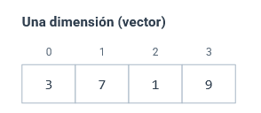

```Python
a = np.array([3, 7, 1, 9])
```

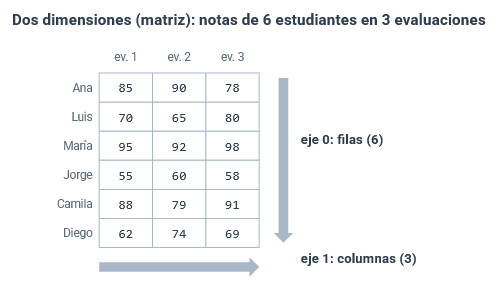

```Python
b = np.array([[85, 90, 78], [70, 65, 80], ..., [62, 74, 69]])
```

Los **atributos de los arreglos** son:

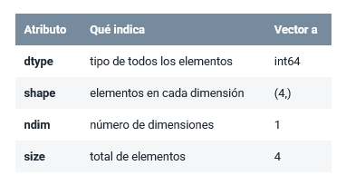

Para el arreglo b, los valores de dichos atributos serían: dtype -> int64, shape -> (6, 3), 
ndim -> 2, size -> 18.

Podemos crear arreglos a partir de listas, pero no es la única forma de hacerlo. Existen varias
formas para crear arreglos:

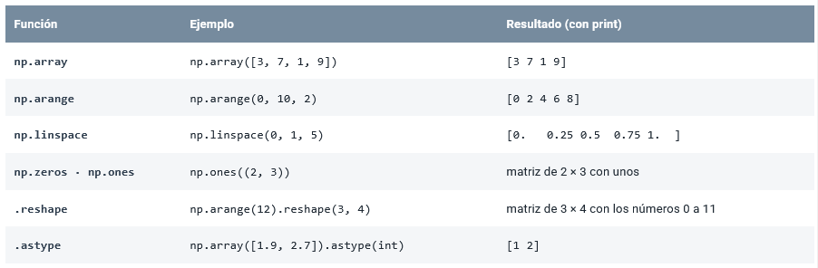

astype(int) **trunca**, **no redondea**.

Cabe recalcar que un arreglo es homogéneo, es decir, todos sus datos son del 
mismo tipo: Un sólo decimal automáticamente convierte todo el arreglo a float64; 
un texto convierte todo a texto. 

### Indexación y slicing en dos dimensiones

Para acceder a cada elemento en particular del arreglo, procedemos con indexación
y slicing.

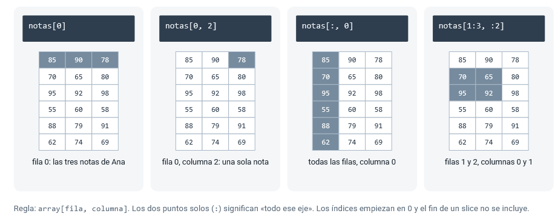

### Vistas y copias

En Python, cuando:

```Python
nota = 5

otra_nota = 10

nota = otra_nota

nota = 0

print(nota, otra_nota)
```

Es decir, no importa si `nota` ha sido asignada como `otra_nota`, nunca
modificamos `otra_nota`. En numpy, sucede lo contrario.

```Python
primera = notas[0, :]        # vista: guardar referencia de la tabla en otra variable
primera[0] = 100
print(notas[0])
# [100  90  78]

notas[0, 0] = 85              # se restaura
copia = notas[0, :].copy()    # copia: guarda COPIA de la tabla en otra variable
copia[0] = 100
print(notas[0])
# [85 90 78]
```

### Operaciones vectorizadas y funciones universales

Como fue dicho al inicio, podemos realizar operaciones entre arreglos.

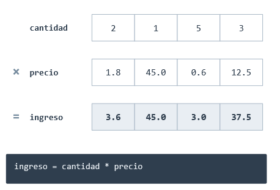

Las siguientes funciones universales actúan por cada elemento del arreglo:

```Python
np.sqrt(precio)  -> raíz cuadrada de cada x     np.abs(x) -> Valor abs. de cada x
np.floor(x)      -> piso de cada x              np.log(x) -> Logaritmo de cada x
np.maximum(a, b) -> máximo de cada x            np.exp(x) -> Exponencial de cada x
```

No son las únicas formas de operar comparando elemento a elemento. De hecho:

```Python
precio > 10 # Del arreglo precio
# [False  True False  True]
```

### Máscaras booleanas

Una máscara booleana es una condición aplicada a un arreglo. El resultado **siempre**
será un arreglo con valores booleanos. El arreglo retornado es del mismo tamaño del 
arreglo original, además True: 1 y False: 0 al querer hacer operaciones.

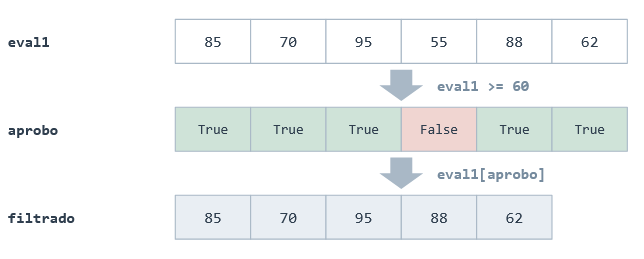

Podrías contar a las personas aprobadas (aprobo.sum()), el promedio de personas
aprobadas (aprobo.mean()), ...

Al aplicar condiciones a los arreglos, también podemos no solo tener una proposicón
simple sino proposiciones compuestas con **&**, **|** y **~**.

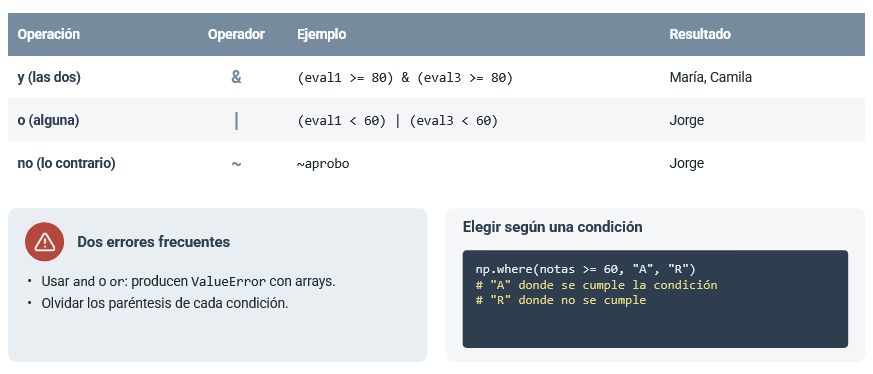

### Agrupaciones y ejes

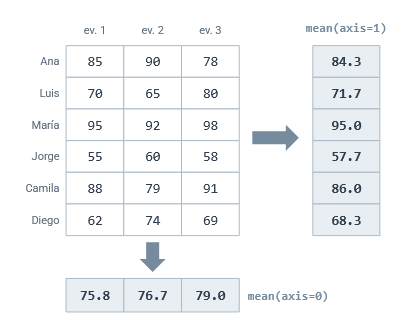

El `axis = 0` colapsa todas las columnas en una sola fila, `axis = 1` colapsa
a todas las filas en una sola columna. Cuando realizamos una acción con los axis,
normalmente suelen ser las siguientes agrupaciones:

```Python
.sum()  .mean() -> media  .std()    -> desviación estandar
.min()  .max()            .argmax() -> índice de elemento más grande
```

Cabe recalcar que argmax() **por sí solo**, en una matriz, retorna el índice 
del elemento con más valor del arreglo de una dimensión. Si (7, 4) entonces 
argmax() te podría retornar 23 perfectamente (No te retorna la ubicación en la
matriz).

Otra situación interesante de numpy es la siguiente:

```Python
import numpy as np

arreglo = np.array(["lunes", "martes", "miercoles", "jueves", "viernes"])

print(arreglo[[1, 3, 0, 0]])
# Output: ["martes, "jueves", "lunes", "lunes"]
```

### Broadcasting básico

Consiste en cómo numpy suma arreglos con matrices. Si a.shape(): (a, b) 
y b.shape(): (b, c), o a.shape(a, b) y b.shape(a, c) entonces sí es posible 
realizar operaciones entre ellos (siendo c = 0 también es posible).

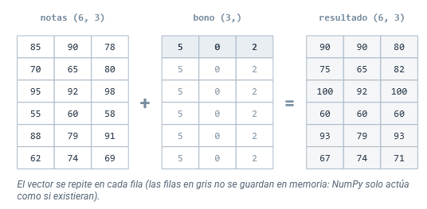

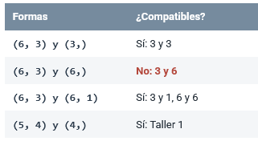

### Leer datos de un archivo con np.loadtxt

Hemos visto cómo trabajar de forma básica con los datos pero no cómo
importarlos.

```Python
precio = np.loadtxt(
    "datos/ventas_tienda.csv",
    delimiter=",",      -> De qué forma quieres que separe las columnas
    skiprows=1,         -> 1: omite la fila de encabezados, 0: no omite
    usecols=4,          -> desde la columna 0 hasta 4.
    encoding="utf-8")   -> formato de texto
```

### Errores frecuentes y su solución

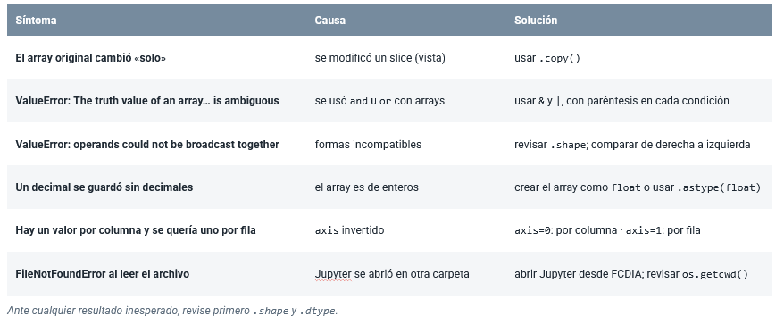

## Estructuras de representacion de datos: Pandas

Me gustaría introducir a pandas con la frase que dijo mi profesor; *"Pandas es Numpy*
*pero con esteroides"*. Numpy no nos sirve para leer datos y mostrarlos de forma
eficiente **por sí solo**. Por otro lado, Pandas nos ayuda a leer datos de forma más 
eficiente **con tablas** (llamadas Dataframes).

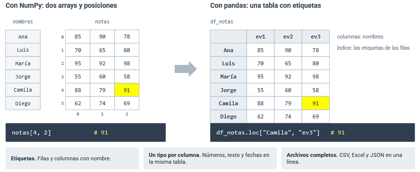

Ahora tenemos tablas (**Dataframes**), de donde cada columna y fila tiene
etiquetas. Cada Dataframe es un conjunto de Series.

### Series: un array con etiquetas

Una Serie es un arreglo de numpy pero con etiquetas. Se pueden crear de la siguiente 
forma:

```Python
ev1 = pd.Series({"Ana": 85, "Luis": 70, "María": 95, "Jorge": 55, "Camila": 88, "Diego": 62}, name="ev1")
```

Tendríamos una serie tal que:

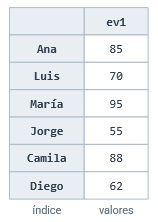


```Python
ev1["María"]         # 95   etiqueta
ev1.iloc[2]          # 95   posición -> es indexación pero con Numpy
ev1["Luis":"Jorge"]  # 3 valores:
                     # fin incluido -> NO como numpy
 
ev1 + 5              # vectorizado (Operaciones)
ev1[ev1 >= 80]       # máscara
ev1.mean()           # 75.83
ev1.idxmax()         # 'María'
ev1.to_numpy()       # Lo convierte en un arreglo de numpy
```

### Dataframes: conjunto de Series

Un dataframe es una tabla. Aunque, en realidad, un dataframe es un conjunto
de series. Dado que son Series independientes, cada columna puede tener
un tipo de valor distinto. Observe lo siguiente:

```Python
nombres = np.array(["Ana", "Luis", "María", "Jorge", "Camila", "Diego"])
notas = np.array([[85, 90, 78],
                  [70, 65, 80],
                  [95, 92, 98],
                  [55, 60, 58],
                  [88, 79, 91],
                  [62, 74, 69]])

notas[4, 2]     # ¿De quién es esta nota y de qué evaluación? El array no lo dice

# con Index nos referimos a las etiquetas
df_notas = pd.DataFrame(notas, index=nombres, columns=["ev1", "ev2", "ev3"])
df_notas

df_notas.loc["Camila", "ev3"]     # la misma nota, ahora pedida por sus etiquetas
```

En numpy teníamos un conjunto de atributos, ahora en Pandas, añadimos unos cuantos
más:

```Python
print(df_notas.shape)      # (filas, columnas), igual que en NumPy
print(df_notas.index)      # las etiquetas de las filas
print(df_notas.columns)    # las etiquetas de las columnas
```

### Las operaciones se alinean por etiqueta

En numpy, automáticamente se hacía un broadcasting cada vez que queríamos
sumar un arreglo con una matriz. En Pandas, se opera etiqueta a etiqueta:

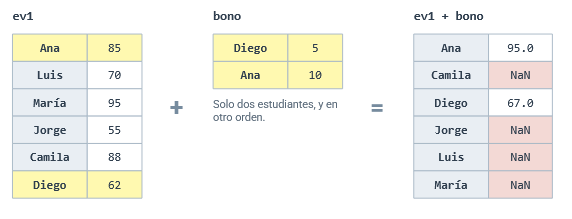

Se puede evidenciar que el orden no importa (como en Numpy), sino que lo único 
que importa es que exista una relación etiqueta a etiqueta.

> NaN: Significa Not a Number

### Leer e inspeccionar: lo primero con datos nuevos

Al momento de leer datos, Numpy nos permitía usar la función loadtxt:

```Python
cantidad = np.loadtxt(ruta,
    delimiter=",", skiprows=1,
    usecols=3, dtype=int,
    encoding="utf-8")
precio = np.loadtxt(ruta, ...)
categoria = np.loadtxt(ruta, ...)
```

En pandas, el proceso se reduce a pocas líneas de código:

```Python
ventas = pd.read_csv(
    "datos/ventas_tienda.csv")
```

- read_csv(): usa la primera fila como nombres de columna y decide el tipo de cada
columna.

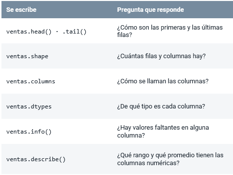

Un vistazo general de un Dataframe, con índices (filas) y sus columnas:

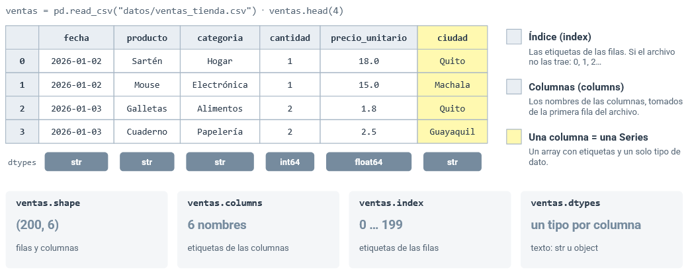

### Columnas: seleccionar y crear

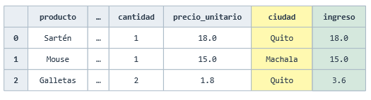

- ventas["ciudad"]: Retorna una serie de 200 valores.

- ventas[["producto", "ciudad"]]: Retorna un Dataframe de 200 x 2 valores.

- ventas["ingreso"] = ventas["cantidad"] * ventas["precio_unitario"]: Crea la columna
ingreso como el producto entre cantidad y precio_unitario.

Para conocer de forma rápida los valores de las columnas:

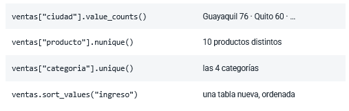

- unique(): retorna un array de numpy de los valores distintos en una columna.

- nunique(): retorna la cantidad de valores distintos presentes en la columna.

- `ventas["ciudad"].value_counts(dropna=False)`: dropna controla si se incluyen o 
se ignoran los valores nulos (NaN) -> False: cuenta los nulos.


### Filas: iloc por posición, loc por etiqueta

- df_notas.iloc[1:4, 0:2]

    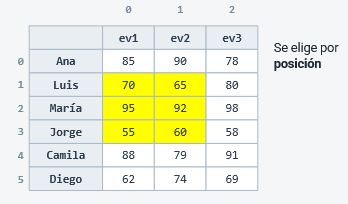


    > df.iloc[]: el fin del slice NO se incluye.

- df_notas.loc["Luis":"Jorge", "ev1":"ev2"]

    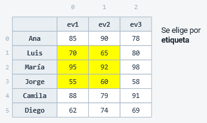

    > df.loc[]: el fin del slice SÍ se incluye.

### Cuando la posición y la etiqueta dejan coincidir

El uso de .loc() e .iloc() debe ser empleado con razón:

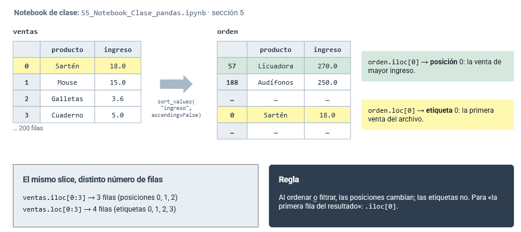


### Condiciones: la máscara, ahora con etiquetas

Con dataframes podemos realizar mascaras booleanas también. De hecho:

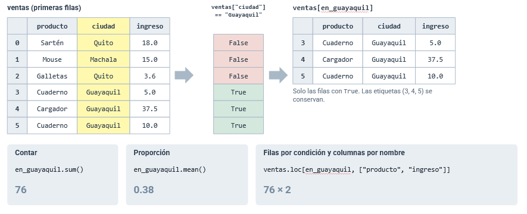

Note `ventas.loc[ventas["ciudad"] == "Guayaquil", ["producto", "ingreso"]]`, en general
df.loc(p, ["columna1", ..., "columnaN"]) -> muestra las columnas N según el
predicado p.

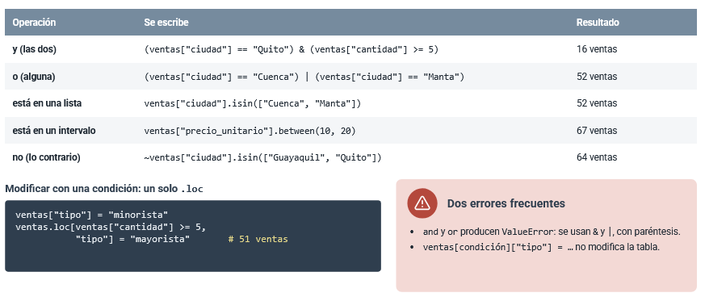

### Tipos de dato

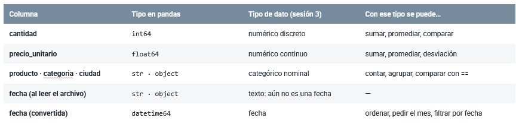

Como se puede observar, Pandas no convierte automáticamente los tipos de dato
que impliquen fechas. Para hacerlo, disponemos de `ventas["fecha"] = pd.to_datetime(ventas
["fecha"])`. dt se usa en Pandas de la siguiente forma:

```Python
print(ventas["fecha"].min(), "→", ventas["fecha"].max())
print(ventas["fecha"].dt.month.head(3).tolist())            # .dt da acceso a las partes de la fecha
print(ventas["fecha"].dt.dayofweek.head(3).tolist())        # día de la semana: 0 = lunes … 6 = domingo
print((ventas["fecha"] >= "2026-03-01").sum(), "ventas en marzo")
```

Para regresar un dataframe a una matriz de Numpy, usamos `df.to_numpy()`

## Limpieza y preparación de datos

En la vida real, nunca nos llegan datos tan limpios como los que se mostraron en los
ejemplos. De hecho, suelen venir con filas duplicadas, valores atípicos, filas con
valores nulos, valores atípicos por malos typeos, etc. Con Pandas podemos limpiar
y preparar a los datos para que nos digan información útil.

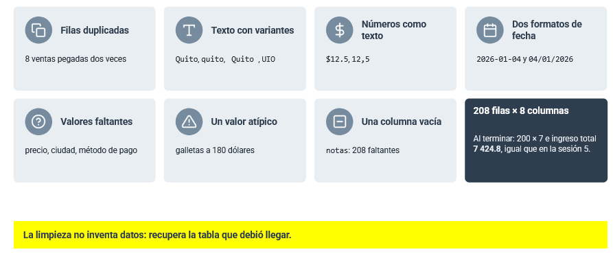

### Medir antes de arreglar los datos

Antes de empezar a limpiar los datos que vamos a revisar, es necesario saber
qué vamos a limpiar. Es decir, nos hacemos las siguientes preguntas:

- ¿Cuántas filas y columnas tiene? -> df.shape, df.info()

- ¿De qué tipo es cada columna? -> df.dtypes, df.info()

- ¿Cuántos valores faltan por columna? -> df.isna().sum() / df.isna() retorna True si hay NaN.

- ¿Cuántos valores faltan de cada columna en total? -> df.isna().sum().sum()
    * df.columns[df.isna().all()] -> -.all(): retorna True si ve una columna entera nula.

- ¿Hay filas repetidas? -> df.duplicated().sum()
    * df.duplicated(keep=valor): valor='first' -> la primera aparición se considera la original.
                                 valor='last' -> sólo la última aparición se considera original.
                                 valor=False -> marca TODAS como no originales.

- ¿Qué variantes tiene el texto? -> df["ciudad"].value_counts(dropna=False)

- Eliminar filas nulas: drop_duplicates() -> elimina filas repetidas.
                        drop(columns=columnas) -> elimina las columnas "columnas"
    * Un buen uso es: `v2 = v.drop_duplicates().drop(columns=v.columns[v.isna().all()])`


### Texto: espacios, mayúsculas y sinónimos

La mayoría de datos cualitativos no vendrán de una "forma bonita", podríamos tener "   Guayaquill" 
en lugar de "Guayaquil".

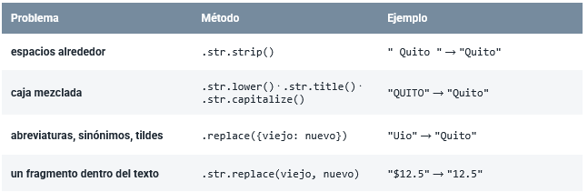

Se aplican de la siguiente forma:

```Python
paso1 = v["ciudad"].str.strip()
paso2 = paso1.str.title()
abrev = {"Gye": "Guayaquil",
         "Uio": "Quito",
         "Cue": "Cuenca",
         "Mec": "Manta",
         "Mch": "Machala"}
v["ciudad"] = paso2.replace(abrev)
 
# categoria (tildes)
cat = (v["categoria"].str.strip()
        .str.lower()
        .replace({"electronica":
                  "electrónica"}))
v["categoria"] = cat.str.capitalize()
```

### Tipos: de texto a número

Hay veces que en los datos podemos encontrar datos que fueron establecidos como
cadenas cuando realmente son flotantes o enteros. Por ejemplo: una columna de precio
con valores como "$20.1", "$10.2" cuando debe ser "20.1", "10.2".

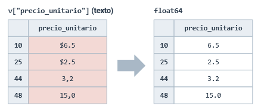

Para el efecto:

```Python
limpio = (v["precio_unitario"]
           .str.replace("$", "", regex=False)
           .str.replace(",", ".", regex=False))

v["precio_unitario"] = pd.to_numeric(limpio, errors="coerce")

v["precio_unitario"].describe()
# Output: count 195   mean 13.9   max 180.0
```

- str.replace(A, B, regex=value): value = False -> le dice a Pandas que interprete el texto
                                  como una cadena literal (el "$" es una instrucción realmente)

- pd.to_numeric(df, errors="coerce"): le dice a Pandas que si encuentra algún valor que no puede
                                      convertir, no explote y simplemente deje ese valor como NaN.


### Fechas en dos formatos: convertir sin riesgo

No sólo podemos rescatar números que Pandas detectó como texto, sino fechas (Que siempre Pandas
las reconocerá como object o str)

con `pd.to_datetime(v["fecha"], format=formato)` podemos establecer el formato que **creemos** que 
tiene el texto que vamos a convertir en fecha


