# Fundamentos de Ciencia de datos e Inteligencia Artificial

## ¿Qué es la ciencia de datos?

La ciencia de datos se define operativamente como **el proceso de obtener conclusiones** 
**útiles a partir de datos para respaldar una decisión**. Para que un proyecto sea exitoso, 
se requiere la intersección de **tres pilares indispensables**:

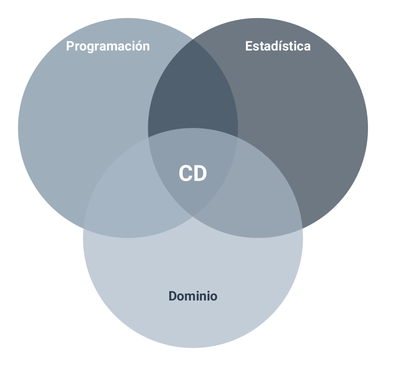

1. Programación: Es la herramienta que nos **permite automatizar tareas repetitivas y procesar volúmenes de**
**datos que sería imposible analizar manualmente**. Se usan librerías especializadas como pandas (Python).

2. Estadística: Nos permite saber si un hallazgo es estadísticamente **significativo o pura** 
**casualidad**, además de estimar cuánta confianza merece un resultado.

3. Conocimiento del Dominio: Sin conocimiento del área, no podemos hacer las preguntas correctas 
ni interpretar si las respuestas del modelo tienen sentido en la vida real.

> Si falta alguno de estos tres pilares, el resultado puede ser muy vistoso visualmente, pero completamente inútil o 
erróneo.

---

## ¿Qué es la Inteligencia Artificial?

La Inteligencia Artificial (IA) se define como **cualquier sistema capaz de realizar tareas que**
**normalmente asociamos con la inteligencia humana (reconocer patrones, predecir, recomendar o decidir)**.

Dentro de la IA **existen distintos niveles de complejidad**:


- IA basada en reglas fijas: Funciona mediante **lógica explícita** programada por un humano.

- Aprendizaje Automático (Machine Learning): El sistema no recibe las reglas escritas a mano, sino que 
**descubre la regla** o el patrón automáticamente a partir de ejemplos (datos).

- Aprendizaje Profundo: Es la tecnología detrás del reconocimiento de voz, visión por computador y 
los chatbots/modelos de lenguaje modernos.

Este curso se enfocará principalmente en **aprendizaje no supervisado** (técnicas como clustering) y tendrá 
una introducción conceptual al aprendizaje supervisado.

### ¿Cómo se relacionan estas disciplinas?

- **Ciencia de Datos**: Es el marco general. Plantea la pregunta, explora los datos, elige el método 
y comunica la respuesta final.

- **IA / Machine Learning**: Es una herramienta dentro de la Ciencia de Datos que aporta los métodos 
para agrupar, predecir o clasificar.

- **Estadística**: Es el fundamento matemático que nos dice qué es una media, una correlación o el margen de error.

- **Ingeniería de Datos**: Se encarga de construir las tuberías y la infraestructura (bases de datos, APIs, flujos) 
para que los datos lleguen limpios y disponibles.

- **El Negocio / Dominio**: Es quien plantea la necesidad inicial y toma la decisión. "Un análisis que no 
respalda una decisión es solo un ejercicio académico, no un proyecto". 

---

## La Jornada de un científico de datos

En encuestas a profesionales, el 80% del tiempo se dedica a obtener, limpiar y comprender los 
datos. Un resumen de lo que realizan los científicos de datos es:

1. Aclarar la pregunta con quien decide -> ¿Qué haría distinto si conociera la respuesta?

2. Obtener y limpiar datos -> Nombres inconsistentes, fechas en tres formatos, valores faltantes.

3. Explorar y graficar -> La mayoría de los hallazgos surgen aquí, antes de cualquier modelo.

4. Modelar -> Seleccionar y ajustar un método; en ocasiones no se requiere ninguno.

5. Comunicar -> Dos gráficos y una recomendación valen más que veinte tablas.

Veamos cómo es realmente el ciclo de vida de un proyecto en ciencia de datos.

---

## Ciclo de vida de un proyecto de ciencia de datos

En la industria, el desarrollo de un proyecto de datos sigue una metodología iterativa conocida como CRISP-DM
(Cross-Industry Standard Process for Data Mining). No es un proceso lineal donde avanzas sin mirar 
atrás; es un ciclo que se repite e itera constantemente.

```
[1. Pregunta] ──► [2. Datos] ──► [3. Preparación]
       ▲                                 │
       │                                 ▼
[6. Comunicación] ◄── [5. Modelo] ◄── [4. Análisis]
```

- **Pregunta**: ¿Qué decisión se quiere tomar? ¿Con qué indicador
se medirá el acierto (KPI)?

- **Datos**: ¿Dónde están? ¿Cómo se obtienen? ¿Pueden usarse?

- **Preparación**: Unir fuentes, corregir, tratar faltantes, estandarizar.

- **Análisis**: Describir, comparar, correlacionar, graficar: ¿qué dicen los datos?

- **Modelo**: Agrupar, predecir o clasificar, solo si la pregunta lo necesita.

- **Comunicación**: Presentar el hallazgo a quien decide y volver al indicador.

Lo escencial es iterar cuando el KPI no mejora.

> KPI (Key Performance Indicator): Es una métrica cuantificable que mide qué tan eficaz es una 
empresa, **un proyecto** o un equipo para alcanzar sus objetivos estratégicos.

### Caso de Estudio Práctico 

Para ver cómo funciona el ciclo en la vida real, analizamos el caso de una cadena de cafeterías que busca 
reducir sus pérdidas:

1. **Pregunta**: ¿Cuánto pan se debe hornear cada día en cada local?
    * KPI actual: Se tiran 40 kg de pan desperdiciado a la semana.
    * Meta KPI: Bajar a 15 kg a la semana en 3 meses.
    * ¿Quién decide? El gerente de operaciones, todas las mañanas a las 5:00 AM.

2. **Datos recolectados**: 
    * Ventas diarias por local (Sistema de caja) -> Numérico + Categórico + Fecha.
    * Clima diario (API pública) -> Numérico.
    * Feriados y eventos (Calendario) -> Categórico.
    * Promociones (Excel de marketing) -> Categórico + Fecha.
    * Reseñas de clientes (App) -> Texto.
    * Problema detectado: ¡Nadie registraba cuánto pan se desechaba por día! 
    Hubo que implementar una regla para empezar a medirlo.

3. **Preparación**: Unificar las 5 fuentes por fecha y local. Corregir inconsistencias 
como "Pan integral", "P. Integral" y "pan intgral".

4. **Análisis**: Identificar qué días se vende más, si las ventas caen cuando llueve o 
qué locales tienen comportamientos parecidos.

5. **Modelo**: En lugar de predecir con ML complejo, se usó Clustering (agrupamiento 
no supervisado) para dividir los 12 locales en 3 perfiles de venta similares y asignar 
un plan de horneado por perfil.

6. **Comunicación**: Un tablero sencillo con 2 gráficos para el gerente. Al cabo de un
mes se mide el KPI: si no bajó a la meta, se ajusta el análisis.

Hay muchas aplicaciones de la ciencia de datos e IA en diversas áreas.

---

## Delimitación de Alcance

Peticiones vagas comunes en la industria (*"Queremos usar IA"*, *"Hagan un dashboard de todo"*) fallan
porque no indican qué decisión cambiará.

### Los 6 Elementos Obligatorios del Alcance

1. **Necesidad y objetivo:** Definición del problema, para quién se resuelve y la meta a lograr.
2. **Decisión y responsable:** Persona encargada, acción concreta que ejecutará y frecuencia de la decisión.
3. **Datos:** Fuentes disponibles, cobertura temporal, custodia y datos faltantes.
4. **Dentro y fuera del alcance:** Fronteras explícitas de lo que se analizará y lo que queda excluido.
5. **Restricciones y riesgos:** Plazos de entrega, barreras de privacidad y problemas de calidad.
6. **Éxito y entregable:** Indicador (KPI) de evaluación y producto final entregable.


---

## Indicadores Clave de Rendimiento - KPIs

* **Diferencia entre Métrica y KPI:**
  * *Métrica:* Dato cuantitativo descriptivo (ej. *"Ventas de ayer: $1,240"*).
  * *KPI:* Métrica cuantificable vinculada a un objetivo estratégico con meta, plazo y
  decisión (ej. *"Reducir el tiempo de espera en caja de 8 a 5 minutos antes del 31 de diciembre"*).

### Criterios SMART (G. T. Doran, 1981)

Un buen KPI es SMART:

* **S**pecific (*Específico*): Mide un único aspecto bien definido.
* **M**easurable (*Medible*): Posee fórmula, unidad de medida y fuente clara.
* **A**chievable (*Alcanzable*): Meta desafiante pero realista.
* **R**elevant (*Relevante*): Conectado con la decisión.
* **T**ime-bound (*Con plazo*): Tiene fecha de corte o frecuencia establecida.

### Tipos de Indicadores

* **Resultado (Lagging):** Mide eventos pasados (ej. supervivencia del camarón al cosechar).
* **Adelantado (Leading):** Anticipa resultados futuros y da margen de acción preventivo (ej. oxígeno mínimo diario).

### La Ley de Goodhart y el Caso Wells Fargo

> *"Cuando una medida se convierte en una meta, deja de ser una buena medida."* — M. Strathern (1997).

* **Caso Wells Fargo (2016-2017):** Se exigió como KPI la cantidad de productos vendidos por cliente. Los 
empleados crearon entre 1.5 y 3.5 millones de cuentas y tarjetas no autorizadas para llegar a la meta, 
generando sanciones por miles de millones de dólares.

* **Protección:** Acompañar siempre cada KPI principal con un **indicador de contrapeso** (ej. ventas brutas vs. tasa de reclamos/cancelaciones).

---

## Formulación de preguntas de negocio

Veamos cómo podemos estructurar preguntas de tal forma de que sean preguntas que quieran datos concretos
y no cosas vagas.

### Tipos de pregunta

1. **Descriptiva (¿Qué pasó?):** *"¿Cuánto se vendió por categoría entre enero y marzo?"* *(Unidad 3)*.

2. **Diagnóstica (¿Por qué pasó?):** *"¿En qué ciudades cayó la venta de la categoría Hogar y*
*qué varió ahí?"* *(Unidad 3)*.
3. **Predictiva (¿Qué pasará?):** *"¿Cuánto se venderá en abril?"* *(Cursos de ML)*.

4. **Prescriptiva (¿Qué conviene hacer?):** *"¿Cuánto inventario debemos pedir por local?"* *(Cursos avanzados)*.

5. **Agrupación / Clustering (¿Qué grupos existen?):** *"¿Qué perfiles de locales tienen comportamientos de venta similares?"* *(Unidad 4)*.

### De pregunta vaga a pregunta respondible

Una buena pregunta es:

- **Específica**: Dice qué se mide y en qué grupo.

- **Medible**: Se responde con los datos disponibles.

- **Útil**: Está ligada a una decisión.

- **Acotada**: Tiene un periodo definido.

- **Comparativa**: Contraste con otro grupo, otro periodo o una meta.

Por ejemplo: 

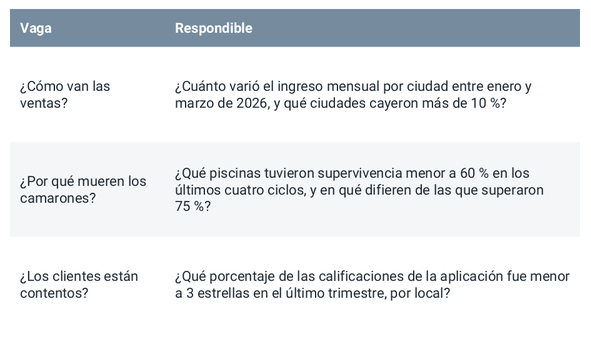

## Big data

Conjuntos de datos cuyo **Volumen**, **Velocidad** o **Variedad** exigen arquitecturas distribuidas
(múltiples máquinas) para su almacenamiento y procesamiento.

1. **Volumen:** Escala cuantitativa de datos (de Gigabytes a Petabytes).
2. **Velocidad:** Ritmo al que se generan y procesan los datos (lotes o tiempo real).
3. **Variedad:** Diversidad de formatos (tablas, texto libre, imágenes, logs).
4. **Veracidad:** Calidad, sesgos y nivel de confianza de los registros.
5. **Valor:** Utilidad práctica para soportar decisiones.


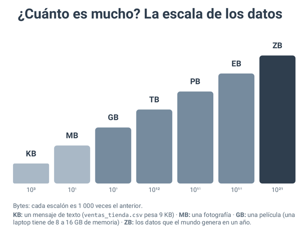

Si los datos caben en la memoria del computador -> no es Big Data: se analizan con pandas.

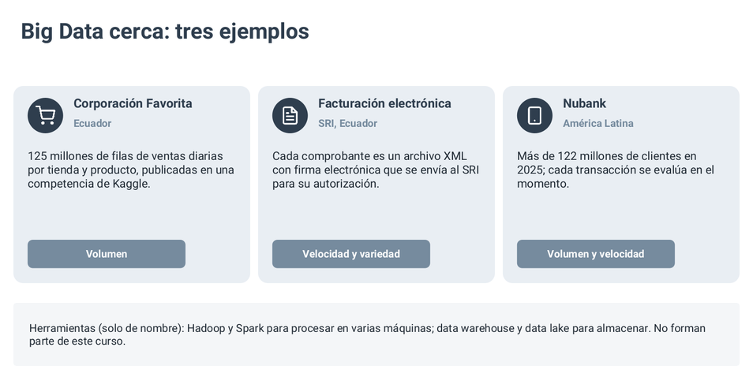

## Datos estructurados

En el repositorio llamado Estructura-de-Datos ya hemos hablado al respecto.

### Niveles de Estructura

* **Estructurados:** Esquema rígido en filas y columnas (Tablas SQL, CSV, Excel).

* **Semiestructurados:** Sin tabla fija, pero con etiquetas o claves jerárquicas (JSON, XML, HTML).

* **No estructurados:** Sin formato predefinido (Texto libre, imágenes, audio, video).

Considere el siguiente ejemplo, el cual muestra la **misma información** de tres formas distintas:


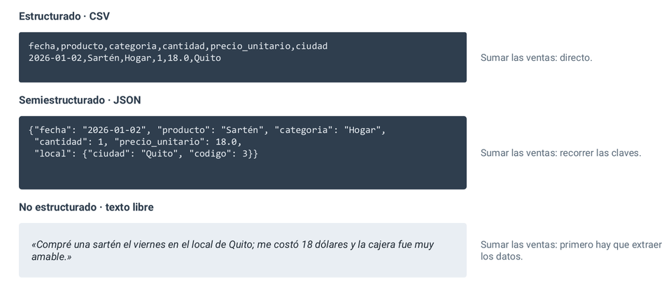

### Tipos de datos

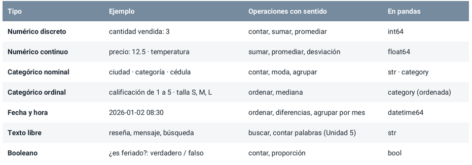

## Estructuras de representación de datos: Numpy

Dado que ya sabemos la teoría básica para entender el mundo de datos y el papel de un
científico de datos, veamos cómo comenzar a trabajar con los datos. Cuando recibamos datos, necesitamos
de algún método / forma para inspeccionar todo ese conjunto de datos de forma eficiente.

Antes de esto, es necesario saber de **numpy**. Numpy es una librería de Python escrita a bajo
nivel (en C), la cual permite operar con arreglos.

En python, podemos guardar datos en diccionarios, listas, etc. Pero no podemos operar directamente con 
ellos, ni consultar información de forma eficiente como lo haríamos con, por ejemplo, una matriz. 

- Lista de python
     ```Python
        lista = [85, 70, 92]
        lista * 2
        # Output: [85, 70, 92, 85, 70, 92]
        ```

- Array de Numpy
     ```Python
        arr = np.array([85, 70, 92])
        arr * 2
        array([170, 140, 184])
        ```

### Anatomía de un Array

Existen arreglos de una y dos dimensiones:

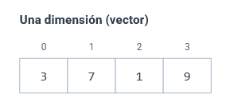

```Python
a = np.array([3, 7, 1, 9])
```

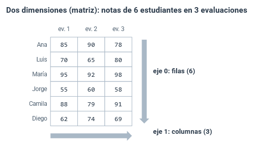

```Python
b = np.array([[85, 90, 78], [70, 65, 80], ..., [62, 74, 69]])
```

Los **atributos de los arreglos** son:

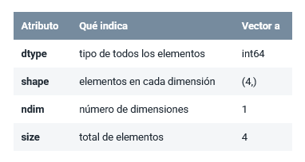

Para el arreglo b, los valores de dichos atributos serían: dtype -> int64, shape -> (6, 3), 
ndim -> 2, size -> 18.

Podemos crear arreglos a partir de listas, pero no es la única forma de hacerlo. Existen varias
formas para crear arreglos:

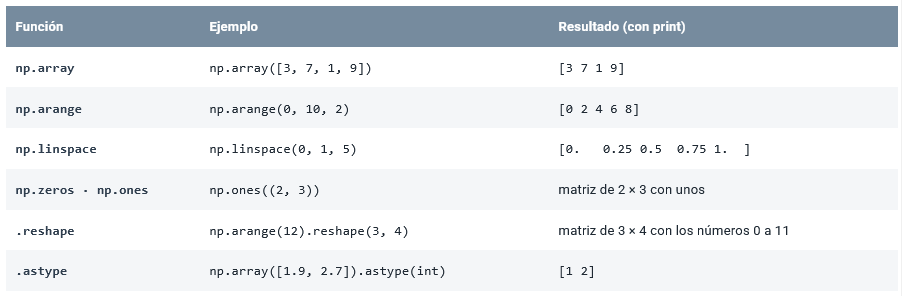

astype(int) **trunca**, **no redondea**.

Cabe recalcar que un arreglo es homogéneo, es decir, todos sus datos son del 
mismo tipo: Un sólo decimal automáticamente convierte todo el arreglo a float64; 
un texto convierte todo a texto. 

### Indexación y slicing en dos dimensiones

Para acceder a cada elemento en particular del arreglo, procedemos con indexación
y slicing.

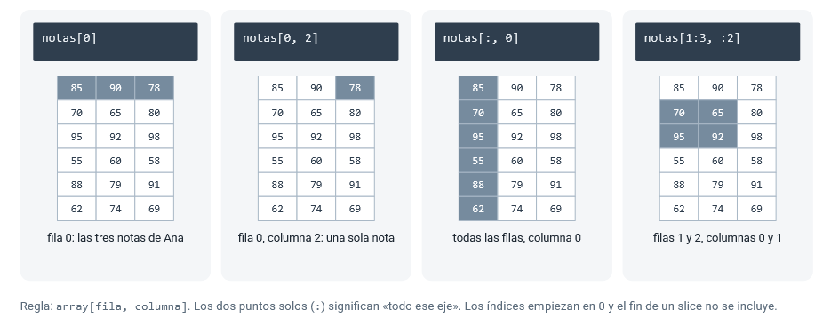

### Vistas y copias

En Python, cuando:

```Python
nota = 5

otra_nota = 10

nota = otra_nota

nota = 0

print(nota, otra_nota)
```

Es decir, no importa si `nota` ha sido asignada como `otra_nota`, nunca
modificamos `otra_nota`. En numpy, sucede lo contrario.

```Python
primera = notas[0, :]        # vista: guardar referencia de la tabla en otra variable
primera[0] = 100
print(notas[0])
# [100  90  78]

notas[0, 0] = 85              # se restaura
copia = notas[0, :].copy()    # copia: guarda COPIA de la tabla en otra variable
copia[0] = 100
print(notas[0])
# [85 90 78]
```

### Operaciones vectorizadas y funciones universales

Como fue dicho al inicio, podemos realizar operaciones entre arreglos.

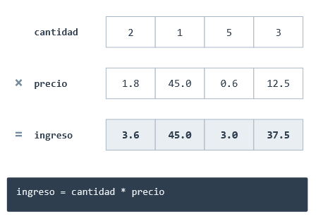

Las siguientes funciones universales actúan por cada elemento del arreglo:

```Python
np.sqrt(precio)  -> raíz cuadrada de cada x     np.abs(x) -> Valor abs. de cada x
np.floor(x)      -> piso de cada x              np.log(x) -> Logaritmo de cada x
np.maximum(a, b) -> máximo de cada x            np.exp(x) -> Exponencial de cada x
```

No son las únicas formas de operar comparando elemento a elemento. De hecho:

```Python
precio > 10 # Del arreglo precio
# [False  True False  True]
```

### Máscaras booleanas

Una máscara booleana es una condición aplicada a un arreglo. El resultado **siempre**
será un arreglo con valores booleanos. El arreglo retornado es del mismo tamaño del 
arreglo original, además True: 1 y False: 0 al querer hacer operaciones.

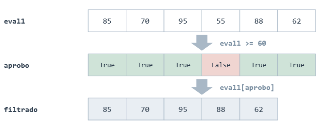

Podrías contar a las personas aprobadas (aprobo.sum()), el promedio de personas
aprobadas (aprobo.mean()), ...

Al aplicar condiciones a los arreglos, también podemos no solo tener una proposicón
simple sino proposiciones compuestas con **&**, **|** y **~**.

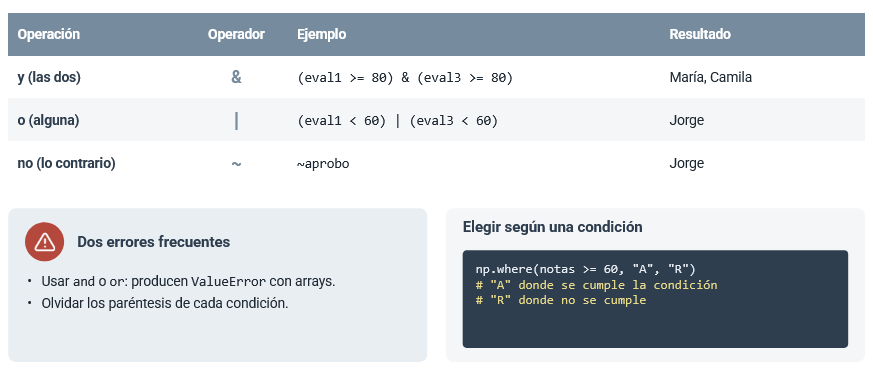

### Agrupaciones y ejes

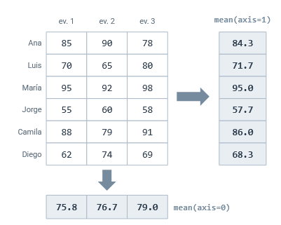

El `axis = 0` colapsa todas las columnas en una sola fila, `axis = 1` colapsa
a todas las filas en una sola columna. Cuando realizamos una acción con los axis,
normalmente suelen ser las siguientes agrupaciones:

```Python
.sum()  .mean() -> media  .std()    -> desviación estandar
.min()  .max()            .argmax() -> índice de elemento más grande
```

Podrías hacer `df.sum()` si y solo si TODAS sus columnas son numéricas o booleanos. Caso contrario
tendrá error al querer sumar. Retorna todas las sumas en cada columna numérica que existe.

Cabe recalcar que argmax() **por sí solo**, en una matriz, retorna el índice 
del elemento con más valor del arreglo de una dimensión. Si (7, 4) entonces 
argmax() te podría retornar 23 perfectamente (No te retorna la ubicación en la
matriz).

Otra situación interesante de numpy es la siguiente:

```Python
import numpy as np

arreglo = np.array(["lunes", "martes", "miercoles", "jueves", "viernes"])

print(arreglo[[1, 3, 0, 0]])
# Output: ["martes, "jueves", "lunes", "lunes"]
```

### Broadcasting básico

Consiste en cómo numpy suma arreglos con matrices. Si a.shape(): (a, b) 
y b.shape(): (b, c), o a.shape(a, b) y b.shape(a, c) entonces sí es posible 
realizar operaciones entre ellos (siendo c = 0 también es posible).

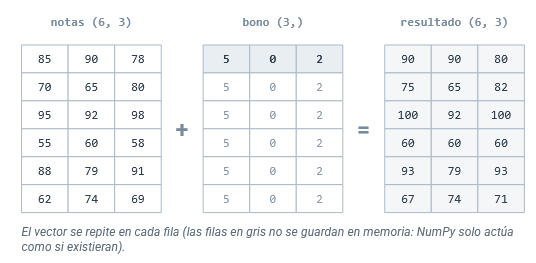

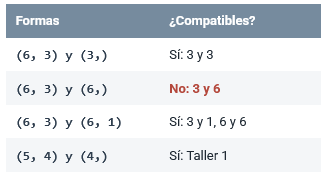

### Leer datos de un archivo con np.loadtxt

Hemos visto cómo trabajar de forma básica con los datos pero no cómo
importarlos.

```Python
precio = np.loadtxt(
    "datos/ventas_tienda.csv",
    delimiter=",",      -> De qué forma quieres que separe las columnas
    skiprows=1,         -> 1: omite la fila de encabezados, 0: no omite
    usecols=4,          -> desde la columna 0 hasta 4.
    encoding="utf-8")   -> formato de texto
```

### Errores frecuentes y su solución

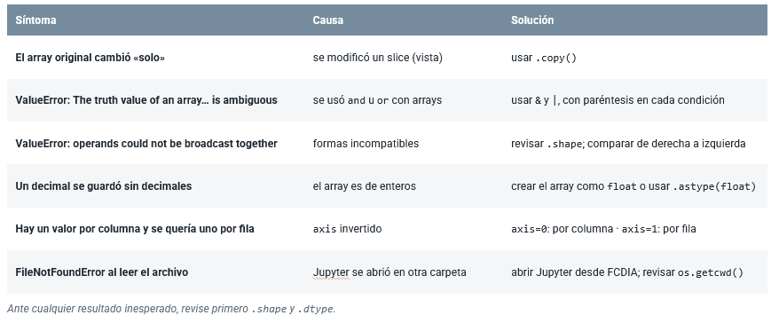

## Estructuras de representacion de datos: Pandas

Me gustaría introducir a pandas con la frase que dijo mi profesor; *"Pandas es Numpy*
*pero con esteroides"*. Numpy no nos sirve para leer datos y mostrarlos de forma
eficiente **por sí solo**. Por otro lado, Pandas nos ayuda a leer datos de forma más
eficiente **con tablas** (llamadas Dataframes).

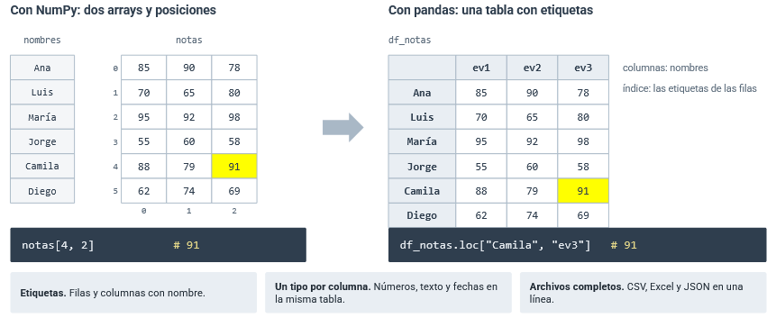

Ahora tenemos tablas (**Dataframes**), de donde cada columna y fila tiene
etiquetas. Cada Dataframe es un conjunto de Series.

### Series: un array con etiquetas

Una Serie es un arreglo de numpy pero con etiquetas. Se pueden crear de la siguiente 
forma:

```Python
ev1 = pd.Series({"Ana": 85, "Luis": 70, "María": 95, "Jorge": 55, "Camila": 88, "Diego": 62}, name="ev1")
```

Tendríamos una serie tal que:

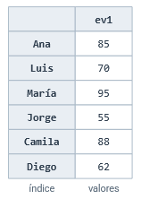


```Python
ev1["María"]         # 95   etiqueta
ev1.iloc[2]          # 95   posición -> es indexación pero con Numpy
ev1["Luis":"Jorge"]  # 3 valores:
                     # fin incluido -> NO como numpy
 
ev1 + 5              # vectorizado (Operaciones)
ev1[ev1 >= 80]       # máscara
ev1.mean()           # 75.83
ev1.idxmax()         # 'María'
ev1.to_numpy()       # Lo convierte en un arreglo de numpy
```

### Dataframes: conjunto de Series

Un dataframe es una tabla. Aunque, en realidad, un dataframe es un conjunto
de series. Dado que son Series independientes, cada columna puede tener
un tipo de valor distinto. Observe lo siguiente:

```Python
nombres = np.array(["Ana", "Luis", "María", "Jorge", "Camila", "Diego"])
notas = np.array([[85, 90, 78],
                  [70, 65, 80],
                  [95, 92, 98],
                  [55, 60, 58],
                  [88, 79, 91],
                  [62, 74, 69]])

notas[4, 2]     # ¿De quién es esta nota y de qué evaluación? El array no lo dice

# con Index nos referimos a las etiquetas
df_notas = pd.DataFrame(notas, index=nombres, columns=["ev1", "ev2", "ev3"])
df_notas

df_notas.loc["Camila", "ev3"]     # la misma nota, ahora pedida por sus etiquetas
```

En numpy teníamos un conjunto de atributos, ahora en Pandas, añadimos unos cuantos
más:

```Python
print(df_notas.shape)      # (filas, columnas), igual que en NumPy
print(df_notas.index)      # las etiquetas de las filas
print(df_notas.columns)    # las etiquetas de las columnas
```

### Las operaciones se alinean por etiqueta

En numpy, automáticamente se hacía un broadcasting cada vez que queríamos
sumar un arreglo con una matriz. En Pandas, se opera etiqueta a etiqueta:

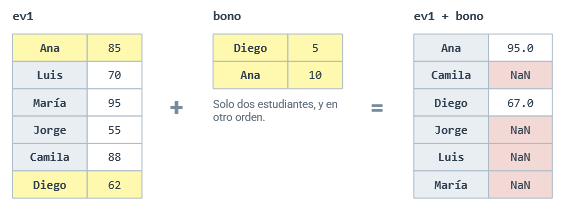

Se puede evidenciar que el orden no importa (como en Numpy), sino que lo único 
que importa es que exista una relación etiqueta a etiqueta.

> NaN: Significa Not a Number

### Leer e inspeccionar: lo primero con datos nuevos

Al momento de leer datos, Numpy nos permitía usar la función loadtxt:

```Python
cantidad = np.loadtxt(ruta,
    delimiter=",", skiprows=1,
    usecols=3, dtype=int,
    encoding="utf-8")
precio = np.loadtxt(ruta, ...)
categoria = np.loadtxt(ruta, ...)
```

En pandas, el proceso se reduce a pocas líneas de código:

```Python
ventas = pd.read_csv(
    "datos/ventas_tienda.csv")
```

- read_csv(): usa la primera fila como nombres de columna y decide el tipo de cada
columna.

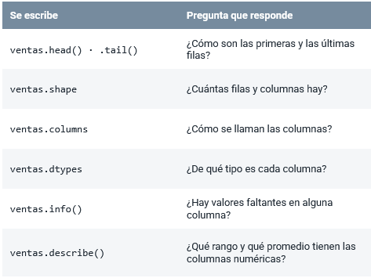

Un vistazo general de un Dataframe, con índices (filas) y sus columnas:

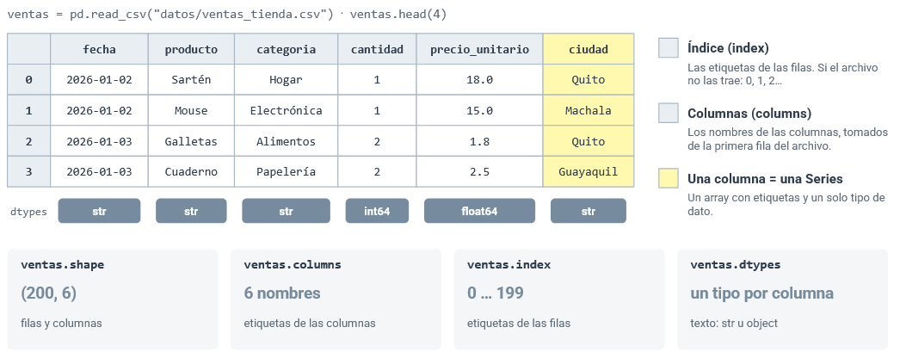

### Columnas: seleccionar y crear

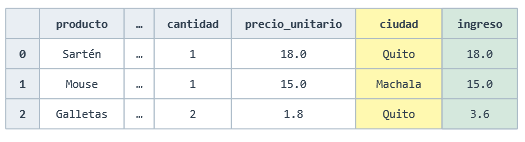

- ventas["ciudad"]: Retorna una serie de 200 valores.

- ventas[["producto", "ciudad"]]: Retorna un Dataframe de 200 x 2 valores.

- ventas["ingreso"] = ventas["cantidad"] * ventas["precio_unitario"]: Crea la columna
ingreso como el producto entre cantidad y precio_unitario.

Para conocer de forma rápida los valores de las columnas:

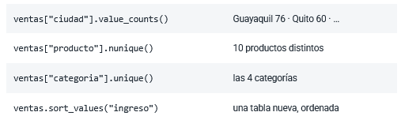

- unique(): retorna un array de numpy de los valores distintos en una columna.

- nunique(): retorna la cantidad de valores distintos presentes en la columna.

- `ventas["ciudad"].value_counts(dropna=False)`: dropna controla si se incluyen o 
se ignoran los valores nulos (NaN) -> False: cuenta los nulos.


### Filas: iloc por posición, loc por etiqueta

- df_notas.iloc[1:4, 0:2]

    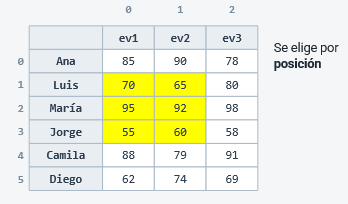


    > df.iloc[]: el fin del slice NO se incluye.

- df_notas.loc["Luis":"Jorge", "ev1":"ev2"]

    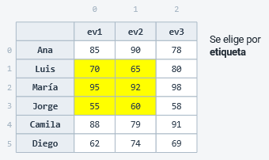

    > df.loc[]: el fin del slice SÍ se incluye.

### Cuando la posición y la etiqueta dejan coincidir

El uso de .loc() e .iloc() debe ser empleado con razón:

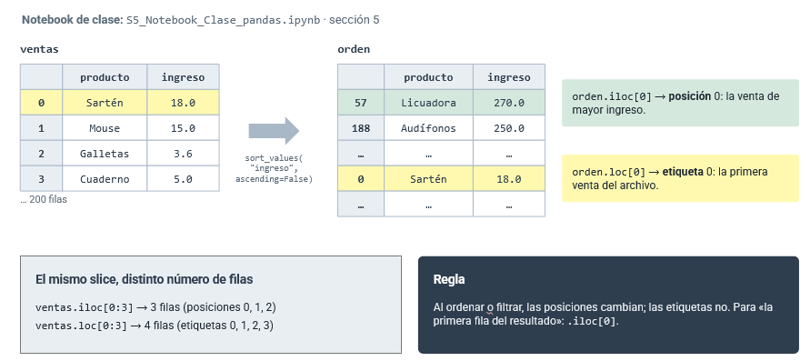


### Condiciones: la máscara, ahora con etiquetas

Con dataframes podemos realizar mascaras booleanas también. De hecho:

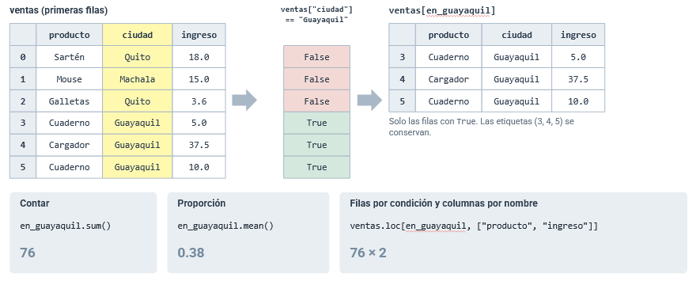

Note `ventas.loc[ventas["ciudad"] == "Guayaquil", ["producto", "ingreso"]]`, en general
df.loc(p, ["columna1", ..., "columnaN"]) -> muestra las columnas N según el
predicado p.

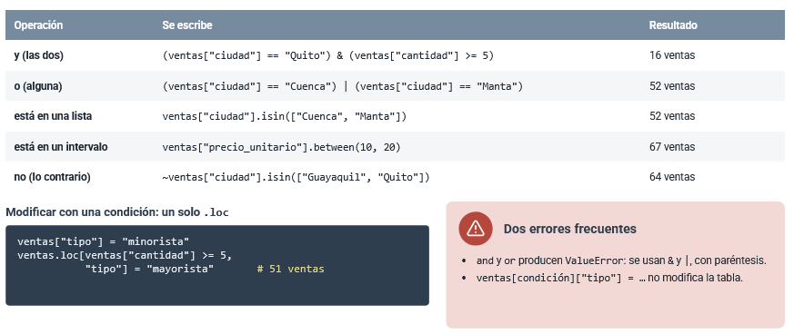

### Tipos de dato

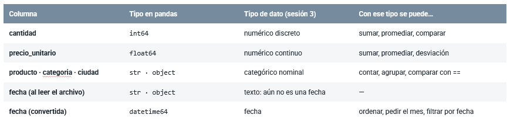

Como se puede observar, Pandas no convierte automáticamente los tipos de dato
que impliquen fechas. Para hacerlo, disponemos de `ventas["fecha"] = pd.to_datetime(ventas
["fecha"])`. dt se usa en Pandas de la siguiente forma:

```Python
print(ventas["fecha"].min(), "→", ventas["fecha"].max())
print(ventas["fecha"].dt.month.head(3).tolist())            # .dt da acceso a las partes de la fecha
print(ventas["fecha"].dt.dayofweek.head(3).tolist())        # día de la semana: 0 = lunes … 6 = domingo
print((ventas["fecha"] >= "2026-03-01").sum(), "ventas en marzo")
```

Para regresar un dataframe a una matriz de Numpy, usamos `df.to_numpy()`

### Guardar los datos

Luego de saber lo básico sobre dataframe. Es necesario además saber cómo podemos exportar
un data frame a un fichero tipo `.csv`.

```Python
ventas.to_csv("ruta", index=False)
```

con `index=False` se indica que el dataframe no incluirá la columna de índices (El número
que identifica a las filas). Caso contrario (True), se incluirá una nueva columna cuyo nombre
es `Unnamed: 0`.


## Limpieza y preparación de datos

En la vida real, nunca nos llegan datos tan limpios como los que se mostraron en los
ejemplos. De hecho, suelen venir con filas duplicadas, valores atípicos, filas con
valores nulos, valores atípicos por malos typeos, etc. Con Pandas podemos limpiar
y preparar a los datos para que nos digan información útil.

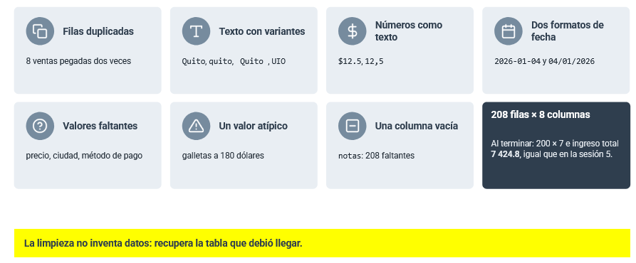

### Medir antes de arreglar los datos

Antes de empezar a limpiar los datos que vamos a revisar, es necesario saber
qué vamos a limpiar. Es decir, nos hacemos las siguientes preguntas:

- ¿Cuántas filas y columnas tiene? -> df.shape, df.info()

- ¿De qué tipo es cada columna? -> df.dtypes, [ df.info() (Estadística general de los datos) ]

- ¿Cuántos valores faltan por columna? -> df.isna().sum() / df.isna() retorna True si hay NaN (Retorna un dataframe donde hay True en las posiciones NaN).

- ¿Cuántos valores faltan de cada columna en total? -> df.isna().sum().sum()
    * df.columns[df.isna().all()] -> -.all(): retorna un df  con True en las columnas llenas de NaN.

- ¿Hay filas repetidas? -> df.duplicated().sum() (Retorna arreglo de booleanos. Con sum retorna cantidad)
    * df.duplicated(keep=valor): valor='first' -> la primera aparición se considera la original.
                                 valor='last' -> sólo la última aparición se considera original.
                                 valor=False -> marca TODAS como no originales.

- ¿Qué variantes tiene el texto? -> df["ciudad"].value_counts(dropna=False)

- Eliminar filas nulas: drop_duplicates() -> elimina filas repetidas.
                        drop(columns=columnas) -> elimina las columnas "columnas"
    * Un buen uso es: `v2 = v.drop_duplicates().drop(columns=v.columns[v.isna().all()])`


### Texto: espacios, mayúsculas y sinónimos

La mayoría de datos cualitativos no vendrán de una "forma bonita", podríamos tener "   Guayaquill" 
en lugar de "Guayaquil".

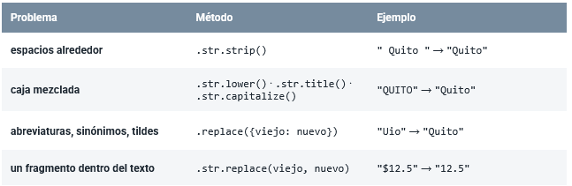

Se aplican de la siguiente forma:

```Python
paso1 = v["ciudad"].str.strip()
paso2 = paso1.str.title()
abrev = {"Gye": "Guayaquil",
         "Uio": "Quito",
         "Cue": "Cuenca",
         "Mec": "Manta",
         "Mch": "Machala"}
v["ciudad"] = paso2.replace(abrev)
 
# categoria (tildes)
cat = (v["categoria"].str.strip()
        .str.lower()
        .replace({"electronica":
                  "electrónica"}))
v["categoria"] = cat.str.capitalize()
```

### Tipos: de texto a número

Hay veces que en los datos podemos encontrar datos que fueron establecidos como
cadenas cuando realmente son flotantes o enteros. Por ejemplo: una columna de precio
con valores como "$20.1", "$10.2" cuando debe ser "20.1", "10.2".

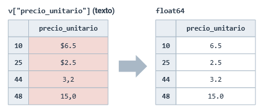

Para el efecto:

```Python
limpio = (v["precio_unitario"]
           .str.replace("$", "", regex=False)
           .str.replace(",", ".", regex=False))

v["precio_unitario"] = pd.to_numeric(limpio, errors="coerce")

v["precio_unitario"].describe()
# Output: count 195   mean 13.9   max 180.0
```

- str.replace(A, B, regex=value): value = False -> le dice a Pandas que interprete el texto
                                  como una cadena literal (el "$" es una instrucción realmente)

- pd.to_numeric(df, errors="coerce"): le dice a Pandas que si encuentra algún valor que no puede
                                      convertir, no explote y simplemente deje ese valor como NaN.


### Fechas en dos formatos: convertir sin riesgo

No sólo podemos rescatar números que Pandas detectó como texto, sino fechas (Que siempre Pandas
las reconocerá como object o str)

con `pd.to_datetime(v["fecha"], format=formato)` podemos establecer el formato que **creemos** que 
tiene el texto que vamos a convertir en fecha. Retorna una fecha con el formato ISO (YYYY-MM-DD). Sin
embargo, antes de convertir el texto a fecha, debemos asegurar el formato que creemos que tendrá 
la cadena a convertir, si no coincide lo deja NaN (errors="coerce").

Por lo tanto, podremos encontrar múltiples filas de una columna "fecha" con diferentes formatos 
de fecha. Para que todo salga bien, aplicamos 2 veces el mismo filtro.

```Python
iso = pd.to_datetime(v["fecha"], format="%Y-%m-%d", errors="coerce")
dmy = pd.to_datetime(v["fecha"], format="%d/%m/%Y", errors="coerce")
v["fecha"] = iso.fillna(dmy)
 
v["fecha"].isna().sum()        # debe dar 0
# Output 0
```


Si de antemano sabe que los datos vienen con el mismo formato de fecha (fechas no sucias). Entonces:

```Python
v = pd.read_csv("datos/ventas_tienda.csv", parse_dates=["fecha"])
```


### Valores faltantes: ver, decidir, rellenar o quitar

Ya sabemos identificar nulos o datos faltantes, pero, ¿Cómo decidimos que valor tendrá
ese valor nulo?

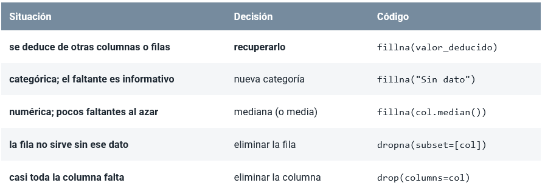

- fillna(dato): rellena con valores nulos con los datos "dato".

Analice con cuidado la siguiente línea de código:

```Python
precio_ref = v.groupby("producto")["precio_unitario"].transform("median") # Se lee como precio por producto
```

- v.groupby("producto")["precio_unitario"].funcion_de_agregación: como en SQL, colapsa todos los productos de tal
forma que sólo habrá un producto apilado por precio unitario. Es muy útil cuando, por ejemplo,
queremos sacar la media del precio de cada producto, etc.

- v.groupby("producto")["precio_unitario"].transform("median"): "haz que cada producto en su
precio unitario sea igual a la mediana" (por eso se agrupa).

### Valores atípicos: detectar es mecánico, decidir no

Un valor atípico (*outlier*) es un dato muy lejos del resto. Puede ser un **error** (un cero de más) 
o un dato **real e importante** (la venta más grande del año). Detectarlo es mecánico; decidir qué 
hacer requiere conocer el negocio.

Tres formas de verlo: `describe()` (mínimo y máximo), un diagrama de caja (*boxplot*) y la regla 
del rango intercuartílico: es atípico lo que queda fuera de `[Q1 − 1.5·IQR, Q3 + 1.5·IQR]`.

Para entenderlo mejor, vamos a proceder con un ejemplo. Note `ventas_sucio.csv` que está
localizado en `./sesion5/datos/ventas_sucio.csv`. Primero analicemos el centro de masa de los
datos, su mínimo y su máximo con `v["precio_unitario"].describe()`. Lo que retorna:

```
count    200.000000
mean      13.064500
std       16.881505
min        0.600000
25%        2.500000
50%       12.500000
75%       18.000000
max      180.000000
Name: precio_unitario, dtype: float64
```

¿Cómo es posible que el valor máximo sea 180 con un centro de masa de 13? Así podrían
verse los atípicos. Si no hay duda respecto a si es atípico o no, lo e

Necesitamos analizar el siguiente caso:

```Python
atipico = v["precio_unitario"] > 100 # Busca mis atípicos (booleanos)
v.loc[atipico, "precio_unitario"] = precio_ref[atipico] # Haz que mi atípico sea igual a la mediana
v["precio_unitario"].max() # Comprobemos si ya no hay atípico
# 45.0
```

Pero esa forma sólo nor sive si sabemos qué valor es el atípico. Por otro lado, el boxplot o
diagrama de caja nos muestra el conjunto de datos y dónde están los valores atípicos:

```Python
import matplotlib.pyplot as plt # Librería para graficar en Python

# 1, 2: Define 1 fila 2 columnas (2 gráficos)
# 9, 3: 9 de ancho por 3 de alto
# fig: figura general
# ejes: las figuras en particular
fig, ejes = plt.subplots(1, 2, figsize=(9, 3))

# Crea un diagrama de caja con columna "precio_unitario" y que lo mande al gráfico 1 de forma horizontal
v.boxplot(column="precio_unitario", ax=ejes[0], vert=False)

# El nombre del gráfico 1
ejes[0].set_title("precio_unitario (con el atípico)")

v.boxplot(column="cantidad", ax=ejes[1], vert=False)
ejes[1].set_title("cantidad")
plt.tight_layout() # Acomoda todo, siempre ponerlo al tener varias imangenes
plt.show()
```

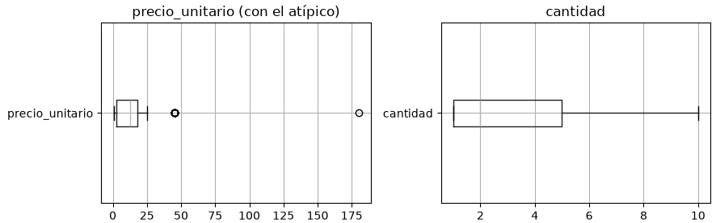

Se puede evidenciar un valor atípico. Sin embargo, no podemos tener el valor 
exacto de ese atípico. Entonces procedemos con la **regla del rango intercuatílico**.

Según la regla del rango intercuartílico, un valor atípico es todo aquel que queda
fuera de `[Q1 − 1.5·IQR, Q3 + 1.5·IQR]`. En efecto:

```Python
q1, q3 = v["precio_unitario"].quantile([0.25, 0.75]) # Los percentiles 25% (q1) y 75%(q2) (Estadística)
iqr = q3 - q1 # Rango intercuartílico
limite_sup = q3 + 1.5 * iqr # Bigote derecho o superior (El izquierdo o inferior no tiene sentido calcular)
print("Q1:", q1, "Q3:", q3, "IQR:", iqr, "límite superior:", limite_sup)
v[v["precio_unitario"] > limite_sup]

# Output: Q1: 2.5 Q3: 18.0 IQR: 15.5 límite superior: 41.25
```

De ahí, entre los demás valores, tendremos las galles de $180 que tanto buscábamos:

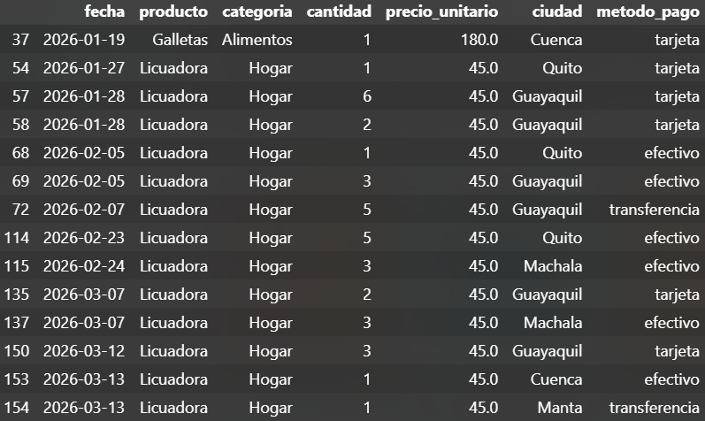

Ahora, el valo de $180 ¿es un error o un dato real?

- Error: galletas a 180 cuando las demás cuestan 1.8 → dos ceros de más. Se corrige con el 
precio del producto y se documenta.

- Dato real: una licuadora a 45 también sale del bigote; es la venta más cara y se queda.

Se deben corregir los errores evidentes; nunca borrar un dato porque estorba.

### Categóricos y estandarización

En lugar de guardar la columna "ciudad" como texto puro (string u object) repitiendo "Guayaquil" 
500 veces, la conviertes al tipo especial de Pandas category: 

```Python
v["ciudad"] = v["ciudad"].astype("category")
```

Internamente Pandas asigna un número pequeño (0 para Cuenca, 1 para Guayaquil, 2 para Quito) 
y una sola tabla de etiquetas. Ademas permite definir un orden lógico entre palabras, por ejemplo,
imagine que tiene una columna de tallas, bastaría con hacer un df["camisas"].sort_values() para
mostrar la talla en orden "pequeño" < "mediano" < "grande".

```Python
import pandas as pd

df = pd.DataFrame({
    "producto": ["Camiseta A", "Camiseta B", "Camiseta C"],
    "talla": ["mediana", "pequeña", "grande"]
})

df["talla"] = pd.Categorical(
    df["talla"], 
    categories=["pequeña", "mediana", "grande"], 
    ordered=True
)
```

En este apartado con estandarización nos referimos a dejar registros con ciudades como Gye, Quit, quiTo
como Guayaquil, Quito. O también a dejar el formato de las fechas de forma correcta. 

### Resumen de lista de verificación

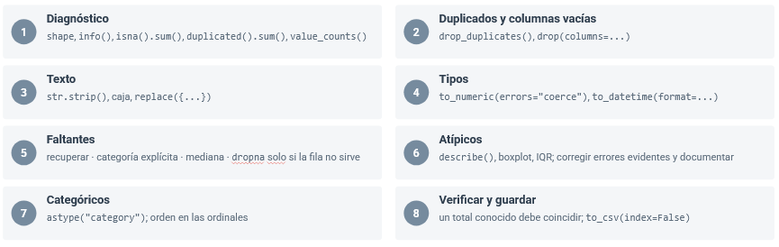


## Filtrar, ordenar y agrupar

Ahora que ya tenemos datos limpios es momento de preguntar **Datos, ¿Qué información puedo obtener de ustedes?**

### Filtrar y ordenar

Para no llenar los apuntes con tanta palabra, observe la siguiente tabla:

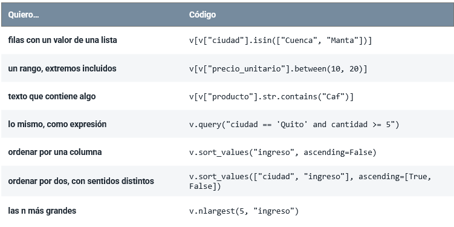

con los n más grandes se refiere a los 5 registros que generaron mayor ingreso (En este caso). Nótese que:

```Python
v.nlargest(5, ["ingreso"]) <=> v.sort_values("ingreso", ascending=False).head(5)
```

### Groupby: dividir, aplicar, combinar

Es, en escencia, el mismo GROUPBY de SQL. `groupby` hace tres cosas en una línea: **divide** la tabla en grupos 
según una columna, **aplica** una función a cada grupo y **combina** los resultados en una tabla nueva, con una 
fila por grupo. El resultado es una Series (o DataFrame) cuyo **índice son los grupos**.

```
v.groupby("ciudad")["ingreso"].sum()         <=> Ingreso por ciudad
   └── clave ──┘   └ columna ┘ └ función ┘
```

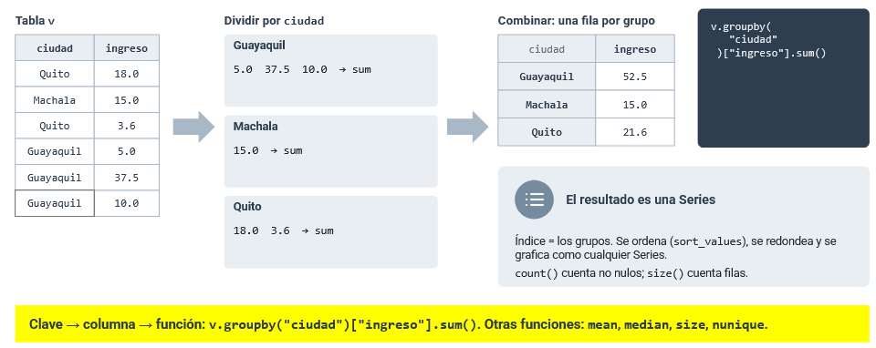

### Varias claves y varias funciones: agg

Con una **lista de columnas** como clave, los grupos son todas las combinaciones (ciudad × categoría) y el 
resultado tiene un índice de dos niveles (`MultiIndex`). Con `agg` se piden varias funciones a la vez, y con 
la **agregación con nombre** cada resultado recibe el nombre de columna que usted elija. Es básicamente
agrupar después de agrupar. Por ejemplo:

```Python
por_cc = v.groupby(["ciudad", "categoria"])["ingreso"].sum()
por_cc.head(8)
```

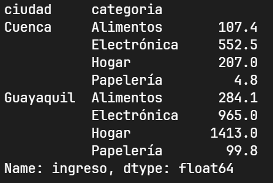

Como se puede observar, agrupamos categoria por ciudad. Aunque no es buena idea representar datos
con tablas, expresemos esa serie como una tabla intercambiando sus índices por sus columnas y viceversa:

```Python
# unstack() lleva el segundo nivel del índice a columnas: una tabla ciudad × categoría
por_cc.unstack().fillna(0).round(1)
```

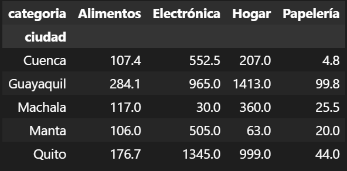

En lugar de agregar una sola función de agregación a una sola columna, puede:

```Python
# Varias funciones sobre una columna
v.groupby("ciudad")["ingreso"].agg(["sum", "mean", "count"]).round(2)
```

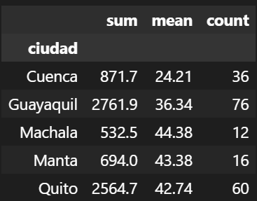


también pudiera cambiar el nombre de dichas columnas:

```Python
# Agregación con nombre: nombre_nuevo = (columna, función). Es la forma más legible.
resumen = v.groupby("ciudad").agg(
    ingreso=("ingreso", "sum"),
    ticket=("ingreso", "mean"),
    ventas=("ingreso", "size"),
    unidades=("cantidad", "sum"),
).round(2)

resumen
```

Actualmente, note que la tabla tiene el índice como la ciudad. Si no queremos usar ciudad como índices:

```Python
# El resultado de groupby tiene los grupos en el ÍNDICE. reset_index() los convierte en una columna normal.
resumen.reset_index().head(3)
```

### De la agregación al indicador

Ahora que ya tenemos más dominio sobre pandas, podemos plantear KPIs claves para saber el avance
de nuestro proyecto de ciencia de datos. Anteriormente, lo definimos sólo como frases, pero ahora:

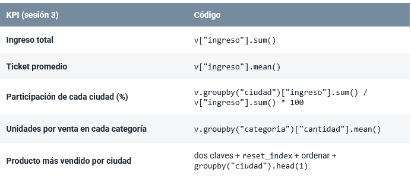

Para recordar sobre el uso de transform, observe el siguiente ejemplo:

```Python
# transform: el promedio de SU ciudad al lado de cada venta -> ¿esta venta está por encima del promedio de su ciudad?
v["ticket_ciudad"] = v.groupby("ciudad")["ingreso"].transform("mean")
v["sobre_promedio"] = v["ingreso"] > v["ticket_ciudad"]
v[["ciudad", "producto", "ingreso", "ticket_ciudad", "sobre_promedio"]].head(6)
```

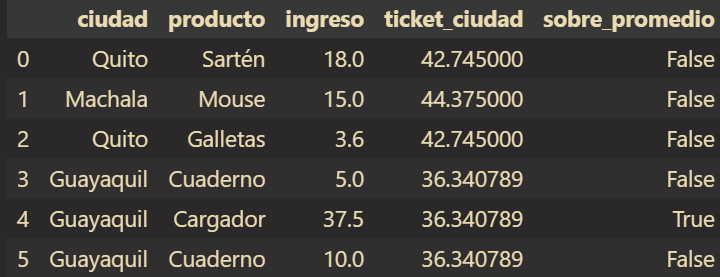

### Pivot_table: La tabla de doble entrada, xd

`pivot_table` es `groupby` con dos claves presentado como una **tabla de doble entrada**: una clave en 
las filas (`index`), otra en las columnas (`columns`), una columna de valores (`values`) y la función de 
resumen (`aggfunc`). `fill_value` reemplaza las combinaciones sin datos y `margins=True` añade los totales. Por ejemplo:

```Python
v.pivot_table(index="ciudad", columns="mes", values="ingreso", aggfunc="sum", fill_value=0, margins=True).round(1)
```

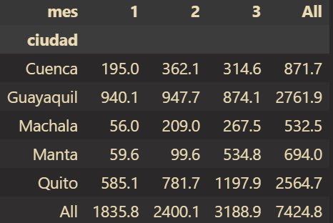


Evidentemente cuando vemos `margins=True` se están añadiendo los marginales, los cuales estudiamos en 
estadística al momento de explicar tablas de doble entrada. Nótese que:

```Python
# Lo mismo con groupby + unstack (sin totales). pivot_table es el atajo.
v.groupby(["ciudad", "mes"])["ingreso"].sum().unstack(fill_value=0).round(1)
```

### crosstab: contar combinaciones

`pd.crosstab(filas, columnas)` **cuenta** cuántas filas hay en cada combinación de dos columnas categóricas. Con
`normalize="index"` cada fila suma 1 (proporción por fila); con `normalize="columns"`, cada columna suma 1. Es la 
herramienta para preguntas del tipo «¿qué proporción de las ventas de cada ciudad es electrónica?». Por ejemplo:

```Python
pd.crosstab(v["ciudad"], v["categoria"], margins=True)
```

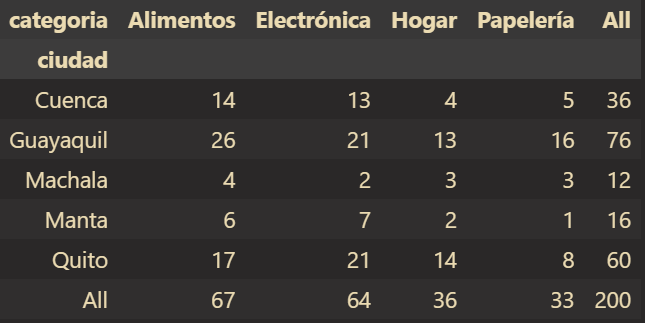

Significa que en Cuenca se registraron 14 ventas (transacciones o filas) pertenecientes a la 
categoría Alimentos. No necesariamente son 14 productos diferentes.

Si quisieramos saber la proporción de cada categoría en cada ciudad, entonces:

```Python
# Proporción dentro de cada ciudad (cada fila suma 1)
pd.crosstab(v["ciudad"], v["categoria"], normalize="index").round(3)
```

> Usa `pd.crosstab` cuando solo quieres contar repeticiones sin funciones de agregación. Usa `df.pivot_table` cuando quieras añadir funciones de agregación.


## Transformar columnas y combinar tablas

Ahora veamos cómo cambiar los datos de una columna. Algunos cambian el valor de un
dato viejo por un dato nuevo, otros cambian agregando una función:

| Herramienta | Qué hace | Cuándo |
| :-- | :-- | :-- |
| `serie.map(diccionario)` | sustituye cada valor por su equivalente; lo que no está en el diccionario queda `NaN` | recodificar: ciudad → región, código → nombre |
| `serie.replace({viejo: nuevo})` | sustituye solo los valores indicados; el resto no cambia | corregir unos pocos valores |
| `serie.map(funcion)` / `serie.apply(funcion)` | aplica una función **elemento a elemento** | cálculo que no es vectorizable |
| `df.apply(funcion, axis=1)` | aplica una función **fila a fila** (recibe cada fila como Series) | la regla usa varias columnas |

`apply` recorre la tabla fila por fila en Python: es el plan B, no la primera opción. Con 200 filas no se nota; con un millón, sí.

Como ya se dijo antes, `Serie` es una columna. Por ejemplo: `v["cantidad"]`. Considere además el siguiente
ejemplo:

### Serie.map(diccionario)

```Python
# map con un diccionario: ciudad -> región. Lo que no está en el diccionario queda NaN.
REGION = {"Guayaquil": "Costa", "Manta": "Costa", "Machala": "Costa", "Quito": "Sierra", "Cuenca": "Sierra"}

v["ciudad"].map(REGION).value_counts(dropna=False)
# Output
# ciudad
# Costa     102
# Sierra     92
# NaN         6
# Name: count, dtype: int64
```

Así, realmente no está modificando el dataframe. Para ver los cambios, añada una nueva columna:

```Python
v["region"] = v["ciudad"].map(REGION)
```

Sin embargo, tendrá regiones escritas como NaN ya que la ciudad está como "sin dato". Para arreglar eso:

```Python
region = v["ciudad"].map(REGION).fillna("Sin dato")
```

### Serie.replace({viejo: nuevo})

```Python
# replace cambia solo lo que se indica; lo demás queda igual
v["metodo_pago"].replace({"transferencia": "transf."}).value_counts()

# Output
# metodo_pago
# efectivo       91
# tarjeta        73
# transf.        27
# desconocido     9
# Name: count, dtype: int64
```

### df.apply(funcion, axis=1)

```Python
# apply fila a fila: una regla que usa dos columnas...
def descuento(fila):
    if fila["cantidad"] >= 5 and fila["metodo_pago"] == "efectivo":
        return 0.10
    return 0.0

con_apply = v.apply(descuento, axis=1)

# ...y la misma regla vectorizada, con np.where (preferible)
vectorizado = np.where((v["cantidad"] >= 5) & (v["metodo_pago"] == "efectivo"), 0.10, 0.0)
print("coinciden:", (con_apply.to_numpy() == vectorizado).all(), "| ventas con descuento:", int((vectorizado > 0).sum()))
```

### Categorizar números: cut y qcut

Ahora podemos agarrar un gran conjunto de datos, separarlos por intervalos (datos agrupados) y 
añadirle una etiqueta conforme su ubicación en los datos.

```
pd.cut(v["cantidad"], bins=[0, 2, 5, 10], labels=["pequeña", "mediana", "grande"])
                    └─ cortes: (0, 2]  (2, 5]  (5, 10] ─┘
```

- Los intervalos cierran **a la derecha**: `(0, 2]` incluye el 2. `right=False` los cierra a la izquierda.
- Un valor fuera de los cortes queda `NaN` (sin aviso). Elija el primer y el último corte con margen.
- Sin `labels`, la columna muestra los intervalos. El resultado es una columna **categórica ordenada**: `.cat.categories`, `sort_index()` respeta el orden. Por ejemplo:

```Python
tamano_cut = pd.cut(v["cantidad"], bins=[0, 2, 5, 10], labels=["pequeña", "mediana", "grande"])

tamano_cut.value_counts().sort_index()

# Output
# cantidad
# (0, 2]     105
# (2, 5]      63
# (5, 10]     32
# Name: count, dtype: int64

# Otro Output sin  value_counts()
# 0      pequeña
# 1      pequeña
# 2      pequeña
# 3      pequeña
# 4      mediana
        ...   
# 195     grande
# 196    pequeña
# 197    pequeña
# 198    pequeña
# 199    pequeña
# Name: cantidad, Length: 200, dtype: category
# Categories (3, str): ['pequeña' < 'mediana' < 'grande']
```

Nótese que sin labels tendría:

```Python
tamano_cut = pd.cut(v["cantidad"], bins=[0, 2, 5, 10])

tamano_cut

# Output
# 0       (0, 2]
# 1       (0, 2]
# 2       (0, 2]
# 3       (0, 2]
# 4       (2, 5]
#         ...   
# 195    (5, 10]
# 196     (0, 2]
# 197     (0, 2]
# 198     (0, 2]
# 199     (0, 2]
# Name: cantidad, Length: 200, dtype: category
# Categories (3, interval[int64, right]): [(0, 2] < (2, 5] < (5, 10]]
```


`pd.qcut` corta por **cuantiles**: cuatro grupos con el mismo número de filas (cuartiles), 
diez (deciles)… Los cortes los decide el dato, no usted. Son exactamente los mismos cuantiles 
de estadística donde Q2 es la mediana o el percentil 50. Por ejemplo:

```Python
# qcut: cuatro grupos de ingreso con (casi) el mismo número de ventas. Los cortes salen de los cuantiles.
cuartil = pd.qcut(v["ingreso"], 4, labels=["Q1", "Q2", "Q3", "Q4"])

print(cuartil.value_counts().sort_index().to_dict())

pd.qcut(v["ingreso"], 4).cat.categories

# Output
# {'Q1': 52, 'Q2': 48, 'Q3': 53, 'Q4': 47} -> mostrar cuántos pertenecen a cada categoría
# IntervalIndex([(0.599, 6.4], (6.4, 15.5], (15.5, 50.0], (50.0, 270.0]], dtype='interval[float64, right]')
# .cat.categories -> mostrar cuáles son esas categorías (El intervalo)
```

Si no tuviese labels entonces:

```Python
cuartil = pd.qcut(v["ingreso"], 4)

cuartil

"""
Output
0       (15.5, 50.0]
1        (6.4, 15.5]
2       (0.599, 6.4]
3       (0.599, 6.4]
4       (15.5, 50.0]
           ...      
195    (50.0, 270.0]
196      (6.4, 15.5]
197     (15.5, 50.0]
198     (15.5, 50.0]
199     (0.599, 6.4]
Name: ingreso, Length: 200, dtype: category
Categories (4, interval[float64, right]): [(0.599, 6.4] < (6.4, 15.5] < (15.5, 50.0] < (50.0, 270.0]]
"""
```

> cut cuando los cortes tienen sentido en el negocio; qcut cuando se quieren grupos del mismo tamaño.

### Variables indicadoras: get_dummies

Los algoritmos que aprenderemos más adelante (distancias, *clustering*) solo entienden números. Una 
columna categórica  se convierte en **una columna 0/1 por categoría**: la fila vale 1 en la columna 
de su categoría y 0 en las demás. Son las variables indicadoras (*dummies* o *one-hot*).

- `pd.get_dummies(serie<->columna, dtype=int)`: una tabla con tantas columnas como categorías. Sin `dtype=int` 
las columnas son `True`/`False`.
- `prefix="cat"` nombra las columnas `cat_Alimentos`, `cat_Hogar`…
- `drop_first=True` quita una columna (redundante: se deduce de las otras). Se usa en modelos; aquí no hace
falta.

Hoy basta con saber construirlas y leerlas; se retoman más adelante.

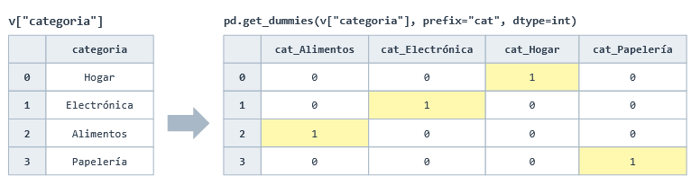

también es posible hacerlo a más de una colmna a la vez. De hecho:

```Python
pd.get_dummies(v[["categoria", "metodo_pago"]], dtype=int)
```

### Unir tablas por una clave: merge

Ahora suponga que en nuestro dataframe df sólo tenemos las columnas `fecha, producto`	
`categoria, cantidad, precio_unitario, ciudad, metodo_pago, tamano, ingreso, region`. Pero
el costo de cada producto está en otra tabla que proviene de un archivo de excel. Entonces:

```Python
productos = pd.read_excel("datos/tienda.xlsx", sheet_name="productos")
locales = pd.read_excel("datos/tienda.xlsx", sheet_name="locales")
```

Ya tenemos las tablas en nuestro código, ¿Cómo relaciono mi df con productos? En general, 
para unir 2 tablas usamos `merge`. Las dos tablas comparten una columna, `producto`: es la **clave**. 
`merge` pega a cada venta la fila del producto que le corresponde.

```
                         v.merge(productos , on="producto", how="left")
    └ otra tabla (o Columnas de otra tabla) ┘ └─ clave ─┘ └ qué filas conservar ┘
```

| `how=` | Conserva… | Si una venta no encuentra su producto |
| :-- | :-- | :-- |
| `"inner"` (por defecto) | solo las claves que están en **ambas** tablas | la venta **desaparece** |
| `"left"` | **todas** las filas de la izquierda | la venta queda, con `NaN` en las columnas nuevas |
| `"right"` | todas las de la derecha | — |
| `"outer"` | todas las de las dos | `NaN` donde falte |

Para enriquecer una tabla con un catálogo, `how="left"` es casi siempre lo correcto: no pierde ventas y deja ver (en los `NaN`) qué claves no se encontraron. Por ejemplo:

```Python
vm = v.merge(productos[["producto", "costo_unitario"]], on="producto", how="left")

vm["margen"] = (vm["precio_unitario"] - vm["costo_unitario"]) * vm["cantidad"]

print(vm.shape, "| costo faltante:", vm["costo_unitario"].isna().sum(), "| margen total:", round(vm["margen"].sum(), 2))

vm.head()
```

Otro ejemplo (Por la ciudad podemos saber el local):

```Python
# Comprobaciones que evitan sorpresas:
#   validate="many_to_one": muchas ventas por producto, pero UN solo producto por clave en el catálogo (si no, error).
#   indicator=True: columna _merge que dice de dónde salió cada fila.
vl = v.merge(locales, on="ciudad", how="left", validate="many_to_one", indicator=True)
vl["_merge"].value_counts()
```

> La tabla de la izquierda `vl` es many y la tabla `locales` es one. Es decir, que habrán muchos 
registros en `vl` con valores en `ciudad` repetidos pero estarán destinado únicamente a un solo 
valor de `ciudad` en la tabla `locales`.

```Python
# Las 6 ventas con ciudad 'Sin dato' no tienen local: con how="left" quedan (con NaN); con how="inner" se pierden
print("left :", v.merge(locales, on="ciudad", how="left").shape)
print("inner:", v.merge(locales, on="ciudad", how="inner").shape)
```

Si las claves se llaman distinto en cada tabla: `left_on="ciudad", right_on="nombre_local"`. Si la 
clave está en el índice: `left_index=True` / `right_index=True`.


### Apilar tablas: concat

Suponga que existen ventas en un dataframe df, pero no son todas las que existen. Las ventas de abril 
llegaron en **otro archivo**, con el mismo tipo de filas. Apilar tablas es `pd.concat([tabla1, tabla2])`:

- Alinea las columnas **por nombre**: una columna que falte en una de las tablas queda `NaN` en esas filas.
- Conserva los índices originales (dos filas con etiqueta 0): `ignore_index=True` renumera.
- `axis=1` pega **de lado** (columnas), alineando por índice; es lo que hace falta para añadir las *dummies*.

Suponga además que la tabla que ya tenemos y sobre la que queremos apilar ya está con sus datos 
limpios, sin embargo, la que vamos a apilar `ventas_abril.csv`, no tiene datos limpios.

Antes de apilar, las dos tablas deben tener los **mismos nombres y tipos** en las columnas comunes. 
`ventas_abril.csv`. Si se apila sin limpiar, `fecha` queda como texto y `precio_unitario` 
también: no se puede sumar. Entonces:

```Python
# Limpieza mínima de abril, como en la sesión 7 (esto NO es nuevo)
abril = pd.read_csv("datos/ventas_abril.csv", sep=";", decimal=",", encoding="latin-1")

abril["fecha"] = pd.to_datetime(abril["fecha"], format="%d/%m/%Y")

abril["ingreso"] = abril["cantidad"] * abril["precio_unitario"]

print(abril.shape, "| ingreso de abril:", round(abril["ingreso"].sum(), 1))

# Para saber qué columnas de mi tabla apilada tienen NaN
print("columnas que v tiene y abril no:", sorted(set(v.columns) - set(abril.columns))) 

abril.dtypes
```

Al apilar:

```Python
# Apilar sin más: 260 filas; las columnas que abril no trae quedan NaN en sus 60 filas
junto = pd.concat([v, abril], ignore_index=True)

print(junto.shape)
```

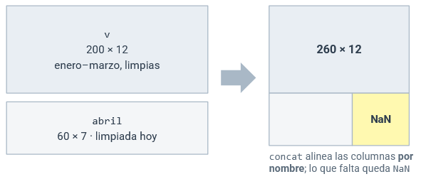

### Formato largo y formato ancho: pivot_table y melt

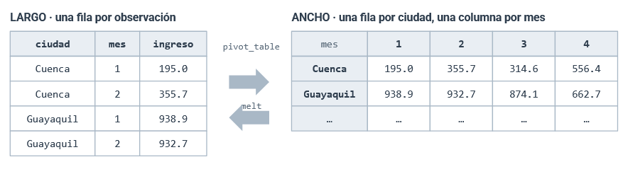

- **Ancho** es lo que lee una persona; es lo que devuelven `pivot_table` y `unstack`.
- **Largo** es lo que prefieren `groupby`, los gráficos y los archivos de datos abiertos. Para volver de ancho a largo: `melt`.

| De… a… | Código |
| :-- | :-- |
| largo → ancho (resumiendo) | `df.pivot_table(index=..., columns=..., values=..., aggfunc=...)` |
| largo → ancho (sin resumir: una fila por combinación) | `df.pivot(index=..., columns=..., values=...)` |
| ancho → largo | `ancho.reset_index().melt(id_vars=..., var_name=..., value_name=...)` |
| nivel de columnas ↔ nivel de índice | `stack()` / `unstack()` |


## Describir una variable

Hasta este momento podemos responder preguntas **agrupando** y **preparando** las tablas. Antes de 
comparar variables entre sí (lo que veremos más adelante) hay que conocer cada una **por separado**: dónde
está su centro, cuánto se dispersa, qué forma tiene, si hay valores extremos. Eso es el análisis
**univariado**. Para entender mejor la explicación que sigue, suponga que trabajaremos con 
un archivo `cosechas.csv` y `ventas_completo.csv`.

```Python
import numpy as np
import pandas as pd
import matplotlib.pyplot as plt

c = pd.read_csv("datos/cosechas.csv", parse_dates=["fecha_siembra"])
v = pd.read_csv("datos/ventas_completo.csv", parse_dates=["fecha"])
print("cosechas:", c.shape, "| ventas:", v.shape)
c.head()
```


Antes de iniciar, recuerde que: dependiendo del tipo de variable contenida en las columnas, podremos
realizar distintas operaciones.

| Tipo de variable | Ejemplo en `cosechas` | Resumen numérico | Gráfico |
| :-- | :-- | :-- | :-- |
| numérica **continua** | `peso_g`, `supervivencia`, `cosecha_kg` | media, mediana, desviación, cuartiles, mínimo y máximo | histograma, diagrama de caja |
| numérica **discreta** (pocos valores) | `densidad`, `dias` | lo mismo, o una tabla de frecuencias si los valores son pocos | barras (o histograma) |
| categórica **nominal** | `zona`, `laboratorio` | frecuencias absolutas y relativas, moda | barras (ordenadas por frecuencia) |
| categórica **ordinal** | `tamano` (en ventas) | frecuencias **en su orden** | barras (en su orden) |
| fecha | `fecha_siembra` | conteo por período | línea en el tiempo |

Un identificador (`ciclo`, `piscina`) no se resume: su «promedio» no significa nada. Lo mismo pasa con un código numérico.

Ya hemos hablado de `dataframe.describe()` el cual describe todas las columnas que sean numéricas.

```Python
c.describe().round(2)
``` 


Si hiciera lo mismo pero involucrando las columnas que no sean numéricas, veríamos otras estadísticas:

```Python
# Las columnas de texto: cuántos valores distintos (unique), el más frecuente (top) y cuántas veces aparece (freq)
c[["zona", "laboratorio", "piscina"]].describe()
```


### Nociones estadísticas

- Observación: Una fila -> Un ciclo de cosecha.

- Variable: Una columna -> peso_g (480 valores).

- Distribución: Cómo se reparten los valores sobre la recta.

- Resumen: Pocos números -> centro y dispersión.

> Describir una variable = un resumen numérico + un gráfico + una frase con un número.


### Las cuatro preguntas a una variable numérica

| Pregunta | El número que la responde | El gráfico |
| :--- | :--- | :--- |
| **¿Dónde está el centro?** | **media** (suma ÷ n) · **mediana** (el valor del medio) | histograma |
| **¿Cuánto se dispersa?** | **desviación** (distancia típica a la media) · **IQR** (el 50 % central) | histograma, caja |
| **¿Qué forma tiene?** | asimetría (`skew`) · media frente a mediana | histograma, violín |
| **¿Hay valores extremos?** | regla **1,5 × IQR** (sesión 7) | diagrama de caja |


### Centro, dispersión y forma de una numérica

El resumen de conceptos estadísticos es: 

#### Centro 

- La **media** (`mean`) suma todo y divide.

- La **mediana** (`median`) es el valor del medio: la mitad de los datos está por debajo. Cuando 
hay valores muy grandes la media se va hacia ellos y la mediana no; por eso **media > mediana** 
avisa de una **cola a la derecha** (asimetría positiva). 

- La **moda** (`mode`) es el valor más repetido: solo tiene sentido en discretas y categóricas.


#### Dispersión

- La **desviación estándar** (`std`) es la distancia típica a la media, en las mismas unidades que la 
variable. 

- Los **cuartiles** (`quantile(0.25)`, `quantile(0.75)`) encierran la mitad central de los 
datos; su diferencia es el **rango intercuartílico (IQR)**, la medida de dispersión que no se deja 
arrastrar por los extremos (la usamos anterioremente para detectar atípicos). 

- El **rango** (`max − min`) depende solo de dos valores: es el más frágil.

#### Forma

`skew()` mide la asimetría: cerca de 0, simétrica; positiva, cola a la derecha; negativa, cola 
a la izquierda.

```Python
col = c["cosecha_kg"]
print("media   :", round(col.mean(), 1))
print("mediana :", round(col.median(), 1), "  <- la media está muy por encima: cola a la derecha")
print("desv.   :", round(col.std(), 1))
print("Q1, Q3  :", col.quantile(0.25), col.quantile(0.75), " IQR =", col.quantile(0.75) - col.quantile(0.25))
print("mín, máx:", col.min(), col.max())
print("asimetría (skew):", round(col.skew(), 2))

"""
Output:
media   : 16645.7
mediana : 14048.0   <- la media está muy por encima: cola a la derecha
desv.   : 11259.4
Q1, Q3  : 9388.75 20973.5  IQR = 11584.75
mín, máx: 2658 146286
asimetría (skew): 4.06
"""
```

Gracias a las funciones de agregación con `df[cols].agg([funciones])`:

```Python
resumen = c[["dias", "supervivencia", "peso_g", "cosecha_kg"]].agg(["mean", "median", "std", "min", "max", "skew"]).round(2)

resumen
```

> Reporte siempre media y mediana: si se separan, la variable tiene cola o atípicos.


### Variables categóricas: tablas de frecuencia

Para una categórica el resumen es **cuántas veces aparece cada valor**: la frecuencia absoluta 
(`value_counts()`) y la relativa (`value_counts(normalize=True)`, que suma 1; multiplicada por 100,
porcentaje). Las dos juntas, en una tabla, son la **tabla de frecuencias**. Ya sabes, las de toda la
vida en un curso inicial de estadística.

```Python
frec_lab = pd.DataFrame({"n": c["laboratorio"].value_counts(),
                         "pct": (c["laboratorio"].value_counts(normalize=True) * 100).round(1)})

frec_lab
```


### matplotlib: la anatomía de un gráfico

Antes ya hemos visto sólo un poco de lo que es representar variables gráficamente, ahora, vamos
a profundizar un poco acerca de la librería que hace posible eso **maplotlib**.

Un gráfico de matplotlib tiene dos piezas: la **figura** (`fig`, el lienzo) y los **ejes** (`ax`, el 
área donde se dibuja; una figura puede tener varios). La receta de siempre:

```python
fig, ax = plt.subplots(figsize=(7, 4))   # 1. lienzo y ejes (ancho, alto en pulgadas)
ax.hist(c["peso_g"], bins=20)             # 2. dibujar sobre los ejes
ax.set_xlabel("peso final (g)")           # 3. etiquetas: qué se mide y en qué unidad
ax.set_ylabel("número de ciclos")
ax.set_title("Peso final por ciclo")
plt.show()
```

> subplots retorna el lienzo completo junto con sus respectivos ejes (X e Y).

Nótese que, en lugar de agarrar un valor cualquiera para `bins`, podemos `bins="sturges"`. Así, aplicamos
el criterio de Sturges.

Las funciones de dibujo (`hist`, `boxplot`, `bar`, `plot`, `scatter`) son métodos de `ax`. Las etiquetas 
son obligatorias: un gráfico sin unidades no se puede leer.


**El atajo de pandas.** Toda Series y DataFrame tiene `.plot`: `c["peso_g"].plot.hist(bins=20)`, 
`frec.plot.bar()`, `c["peso_g"].plot.box()`. Usa matplotlib por dentro y devuelve el `ax`, así que 
las etiquetas se ponen igual. Es más corto; la receta completa manda cuando se necesita control 
(varios paneles, estilos).

```Python
# El mismo gráfico con el atajo de pandas; devuelve el ax, así que las etiquetas se ponen igual
ax = c["peso_g"].plot.hist(bins=20, figsize=(7, 4), color="#768B9E", edgecolor="white")

ax.set_xlabel("peso final (g)")

ax.set_title("Peso final por ciclo (pandas .plot)")

plt.show()
```


### Histograma: la forma de la distribución

El histograma corta el rango de la variable en **intervalos** (`bins`) y cuenta cuántos valores caen 
en cada uno. Lo que se lee en él:

- **Centro**: dónde se acumulan los datos. 

- **Dispersión**: qué tan ancho es.

- **Forma**: simétrica (campana), con **cola a la derecha** (muchos valores pequeños y pocos muy 
grandes: ingresos, cosechas, precios) o a la izquierda; con uno o varios picos.

- **Extremos**: barras aisladas lejos del grueso.

El número de intervalos cambia lo que se ve: con muy pocos se pierde la forma; con demasiados, ruido. 
`density=True` pone proporciones en vez de conteos (útil para comparar grupos de distinto tamaño).

Una línea vertical para la media y otra para la mediana (`ax.axvline`) muestra la asimetría de un vistazo.

```Python
# Pocos, razonables y demasiados intervalos: el mismo dato, tres lecturas
fig, axes = plt.subplots(1, 3, figsize=(12, 3.4)) # 1 fila, 3 columnas

for ax, b in zip(axes, [5, 30, 150]):
    ax.hist(c["cosecha_kg"], bins=b, color="#768B9E", edgecolor="white")
    ax.set_title(f"bins = {b}")
    ax.set_xlabel("cosecha (kg)")

axes[0].set_ylabel("número de ciclos")
fig.tight_layout() # puede usar fig o plt
plt.show()
```


```Python
# Media y mediana sobre el histograma: la media se va hacia la cola
fig, ax = plt.subplots(figsize=(7, 4))
ax.hist(c["cosecha_kg"], bins=30, color="#768B9E", edgecolor="white")

ax.axvline(c["cosecha_kg"].mean(), color="#B4483C", linestyle="--", label=f"media = {c['cosecha_kg'].mean():,.0f}")
ax.axvline(c["cosecha_kg"].median(), color="#2F3E4E", linestyle="-", label=f"mediana = {c['cosecha_kg'].median():,.0f}")

ax.set_xlabel("cosecha por ciclo (kg)")
ax.set_ylabel("número de ciclos")
ax.set_title("Cosecha por ciclo: cola a la derecha")

ax.legend()
plt.show()
```


### El diagrama de caja: cinco números, atípicos y grupos

El diagrama de caja (*boxplot*) dibuja los **cinco números**: la caja va de Q1 a Q3 (la mitad central), 
la línea dentro es la **mediana**, los **bigotes** llegan hasta el último dato que está a menos de 
**1,5 × IQR** de la caja y los puntos de fuera son los **atípicos**.

```
            Q1    mediana   Q3
   |---------[=======|=========]----------|      o    o        o
 bigote       ← caja: 50 % central →    bigote   atípicos (> Q3 + 1,5·IQR)
```

Es menos detallado que el histograma pero compara mejor: varias cajas lado a lado (una por zona) 
muestran **la misma variable por grupos**.

Ahora hagamos un boxplot (o diagrama de caja) con la columna cosecha:

```Python
fig, ax = plt.subplots(figsize=(4, 4.5))

ax.boxplot(c["cosecha_kg"])

ax.set_ylabel("cosecha por ciclo (kg)")
ax.set_xticks([]) # -> No muestres el eje de las x

ax.set_title("Cosecha por ciclo: caja, bigotes y atípicos")

plt.show()
```


> Si quisiera ver el diagrama de caja de forma horizontal -> `ax.boxplot(c["cosecha_kg"], vert=False)`


Como ya se mencionó antes, si quisiera buscar cuáles son exactamente esos atípicos.

```Python
# Los atípicos que dibuja la caja son exactamente los de la regla 1.5 x IQR
q1, q3 = c["cosecha_kg"].quantile([0.25, 0.75])
iqr = q3 - q1
limite = q3 + 1.5 * iqr

atipicos_cos = c[c["cosecha_kg"] > limite]

print("límite superior:", round(limite, 1), "| ciclos por encima:", len(atipicos_cos))

atipicos_cos.nlargest(3, "cosecha_kg")[["ciclo", "zona", "hectareas", "densidad", "supervivencia", "cosecha_kg"]]
```


Un atípico **no es un error** por ser atípico: el ciclo más grande es una piscina de 52 hectáreas 
(real, excepcional). Aquí los valores son legítimos y **se conservan**, pero se mencionan al describir 
la variable, porque arrastran la media.

Se viene lo bueno: Puedes aplicar diagrama de cajas no a una sola variable por gráfico. De hecho:

```Python
# Una variable, varios grupos: supervivencia por zona (pandas construye una caja por grupo)
fig, ax = plt.subplots(figsize=(8, 4))
c.boxplot(column="supervivencia", by="zona", ax=ax, grid=False) # c es nuestro dataframe cosecha

ax.set_xlabel("zona")
ax.set_ylabel("supervivencia (%)")
ax.set_title("Supervivencia por zona")

fig.suptitle("")           # pandas añade un título general; se quita
plt.show()
```


### El violín: la caja con la forma de la distribución

La caja resume cada grupo en cinco números. El **violín** (*violin plot*) dibuja, además, 
la **forma** de cada grupo: es un histograma suavizado, puesto de pie y reflejado. Donde el violín 
es **ancho** hay muchos datos; donde es **estrecho**, pocos; una **punta larga y fina** es una cola
con valores extremos.

- Caja: para comparar medianas y contar atípicos.
- Violín: para ver la forma (dos picos, colas, dónde se concentran los datos).
- Con **pocos datos** por grupo (menos de 30) el violín engaña: conviene usar la caja (boxplot).

```Python
# La misma variable y los mismos grupos que la caja anterior, como violines
nombres = sorted(c["zona"].unique())                              # un nombre por grupo
grupos = [c.loc[c["zona"] == z, "supervivencia"] for z in nombres]  # una columna por grupo

fig, ax = plt.subplots(figsize=(8, 4))
ax.violinplot(grupos, showmedians=True)

ax.set_xticks(range(1, len(nombres) + 1), labels=nombres)
ax.set_xlabel("zona")
ax.set_ylabel("supervivencia (%)")
ax.set_title("Supervivencia por zona: forma de cada grupo")

plt.show()
```


Como puede notar, es más trabajoso mostrar el gráfico de Violín que el de cajas.


### Barras para las categóricas (y por qué no un pastel)

El gráfico de una tabla de frecuencias es el de **barras**: una barra por categoría, 
altura = frecuencia.

- Nominal: barras **ordenadas** de mayor a menor (`value_counts` ya lo hace). Ordinal: **en su orden**.
- Etiquetas largas: barras horizontales (`barh`, o `plot.barh()`).
- El eje de las frecuencias **empieza en cero**; si no, las diferencias se exageran.
- **Nada de pasteles**: el ojo compara mal ángulos y áreas; compara bien longitudes. Todo lo 
que dice un pastel lo dice mejor una barra.

Un histograma es para numéricas (los intervalos son contiguos); las barras, para categorías 
(separadas). No se mezclan.

```Python
frec = c["zona"].value_counts()

fig, ax = plt.subplots(figsize=(7, 3.6))

ax.bar(frec.index, frec.values, color="#768B9E")
ax.set_xlabel("zona")
ax.set_ylabel("número de ciclos")
ax.set_title("Ciclos de cosecha por zona")

# el valor encima de cada barra
for i, n in enumerate(frec.values):           
    ax.text(i, n + 3, str(n), ha="center", fontsize=9)

plt.show()
```


> `serie.index` retorna el valor de cada columna. `serie.values` retorna los valores de cada columna.


### Un panel de gráficos, guardarlo y decir qué se ve

Luego de crear todos esos gráficos por separado, procedemos a "juntarlos" y resumir
qué nos dicen los datos.

```Python
import os # Para guardar la imagen en la PC
os.makedirs("figuras", exist_ok=True) # Creando el directorio a guardar

fig, axes = plt.subplots(2, 2, figsize=(11, 7)) # 2 filas, 2 columnas con un tamaño "grande"
axes[0, 0].hist(c["cosecha_kg"], bins=30, color="#768B9E", edgecolor="white")
axes[0, 0].set_title("Cosecha por ciclo (kg): cola a la derecha")
axes[0, 0].set_xlabel("kg"); axes[0, 0].set_ylabel("ciclos")

axes[0, 1].hist(c["supervivencia"], bins=25, color="#768B9E", edgecolor="white")
axes[0, 1].set_title("Supervivencia (%): aproximadamente simétrica")
axes[0, 1].set_xlabel("%"); axes[0, 1].set_ylabel("ciclos")

axes[1, 0].boxplot(c["peso_g"])
axes[1, 0].set_title("Peso final (g): caja y bigotes")
axes[1, 0].set_ylabel("g"); axes[1, 0].set_xticks([])

frec = c["zona"].value_counts()
axes[1, 1].bar(frec.index, frec.values, color="#768B9E")
axes[1, 1].set_title("Ciclos por zona")
axes[1, 1].set_ylabel("ciclos")

fig.suptitle("Cosechas 2024-2025: descripción de cuatro variables", fontsize=13)
fig.tight_layout()
fig.savefig("figuras/cosechas_univariado.png", dpi=150, bbox_inches="tight")
plt.show()
```


**Lo que dice cada gráfico, en una frase**:

- *Cosecha por ciclo*: la mayoría de los ciclos produce entre 5 000 y 25 000 kg; unos pocos superan 
los 50 000 (piscinas muy grandes) y arrastran la media (16 646 kg) por encima de la mediana (14 048 kg).

- *Supervivencia*: centrada en 67 %, casi simétrica, con tres ciclos por debajo del 40 % que merecen revisarse.

- *Peso final*: la mitad de los ciclos cosecha entre 17,5 y 22 g; solo dos valores (10,7 y 29,1 g) 
quedan fuera de los bigotes, apenas.

- *Zona*: Guayas concentra el 43 % de los ciclos; El Oro, el 24 %.

Cada frase tiene **un número** y **una lectura**.


## Relaciones entre variables: dispersión y correlación

Antes describimos **una variable por separado** (centro, dispersión, forma, atípicos). Sin embargo, 
casi todas las preguntas de negocio relacionan **dos**: ¿los ciclos más largos dan camarones más pesados?,
¿las piscinas más grandes cosechan más?, ¿vender más unidades deja más margen? Veremos cómo **ver** 
una relación (diagrama de dispersión), cómo **medirla** con un número (correlación) y qué **no** dice 
ese número.

### Dos variables numéricas: el diagrama de dispersión

Para ver cómo se relacionan 2 variables x e y usamos un diagrama de dispersión. El diagrama de
dispersión analiza cómo cambian los registros de x e y en cada fila. `axis.scatter(x, y)` lo dibuja.

| Pregunta | Qué mirar | Ejemplo |
| :-- | :-- | :-- |
| **Dirección** | ¿cuando x sube, y sube (positiva) o baja (negativa)? | más días de cultivo → más peso |
| **Forma** | ¿los puntos siguen una **recta**, una curva, o nada? | una recta: relación lineal |
| **Fuerza** | ¿están cerca de la forma o muy dispersos? | una nube ancha: relación débil |
| **Puntos raros** | ¿hay puntos lejos de todos? | una piscina de 52 ha |


```Python
import numpy as np
import pandas as pd
import matplotlib.pyplot as plt

fig, ax = plt.subplots(figsize=(7, 4.5))
ax.scatter(c["dias"], c["peso_g"], alpha=0.5, color="#768B9E") # alpha permite ver grado de acumulación de puntos
ax.set_xlabel("días de cultivo")
ax.set_ylabel("peso final (g)")
ax.set_title("A más días de cultivo, más peso: relación positiva, lineal, moderada-fuerte")
plt.show()
```


### Medir la relación: el coeficiente de correlación de Pearson

El **coeficiente de correlación de Pearson** (`r`) resume la dispersión en un número entre **−1 y 1**:

- el **signo** dice la dirección (estrictamente creciente o estrictamente decreciente);
- el **valor absoluto** dice la fuerza de la relación **lineal**: 1 o −1 es una recta perfecta; 
0 es «ninguna relación lineal».

Se calcula a partir de la **covarianza** (cuánto se mueven juntas las dos variables respecto de sus 
medias) dividida entre las dos desviaciones estándar: por eso **no tiene unidades** y no cambia si 
se pasa de gramos a kilos. En pandas, el coeficiente de correlación: `x.corr(y)` -> `serieA.corr(serieB)`.

| \|r\| | Lectura habitual (guía, no ley) |
| :-- | :-- |
| menos de 0,3 | débil o nula |
| 0,3 a 0,7 | moderada |
| más de 0,7 | fuerte |

Lo que `r` **no** mide: relaciones no lineales (una curva en U puede dar `r ≈ 0`), y es sensible 
a los atípicos (un punto lejano cambia mucho el valor). **Por eso el gráfico va primero**.


Ahora, en `r_ha_cos` está la correlación de Pearson entre `hectareas` y `cosecha_kg` 
y en `r_den_sup` la de `densidad` con `supervivencia`.

```Python
r_ha_cos = c["hectareas"].corr(c["cosecha_kg"])
r_den_sup = c["densidad"].corr(c["supervivencia"])
print("hectáreas-cosecha:", round(r_ha_cos, 2), "| densidad-supervivencia:", round(r_den_sup, 2))
# Output:
# hectáreas-cosecha: 0.84 | densidad-supervivencia: -0.03
```

Observe los diagramas de dispersión:


### Coeficiente de correlación de Spearman: correlación de rangos

El coeficiente de Pearson mide relaciones lineales y es sensible a los datos atípicos. Cuando 
la relación es creciente (o decreciente) pero no lineal, o hay valores atípicos, conviene 
trabajar con los rangos de los datos en lugar de sus valores.

> Rango: posición de x cuando está ordenado de menor a mayor.

La correlación de **Spearman** (`method="spearman"`) hace lo mismo que Pearson pero sobre 
los **rangos** (el puesto de cada valor: 1.º, 2.º, …) en vez de sobre los valores. Mide si
la relación es **monótona** (siempre sube o siempre baja), sea recta o curva. Conviene cuando:

- la relación es claramente **no lineal** pero monótona (una curva que siempre sube).
- hay **atípicos** que deforman a Pearson;
- alguna variable es **ordinal** (una escala de 1 a 5, tallas, niveles).

Si Pearson y Spearman se parecen, la relación es aproximadamente lineal y sin atípicos influyentes. 
Si Spearman es claramente mayor, hay una relación monótona que la recta no captura, o un atípico 
que tira de Pearson.

```Python
# En cosechas: hectáreas-cosecha con y sin el efecto de la piscina de 52 ha
fig, ax = plt.subplots(1, 2, figsize=(10, 4.5))
ax[0].scatter(c["hectareas"], c["cosecha_kg"], alpha=0.5, color="#768B9E")
ax[0].set_xlabel("hectáreas")
ax[0].set_ylabel("cosecha (kg)")
ax[0].set_title(f"Pearson = {c['hectareas'].corr(c['cosecha_kg']):+.2f}")
ax[1].scatter(c["hectareas"], c["cosecha_kg"], alpha=0.5, color="#768B9E")
ax[1].set_xlabel("hectáreas")
ax[1].set_ylabel("cosecha (kg)")
ax[1].set_title(f"Spearman = {c['hectareas'].corr(c['cosecha_kg'], method='spearman'):+.2f}")
plt.show()


print("Pearson :", round(c["hectareas"].corr(c["cosecha_kg"]), 3))
print("Spearman:", round(c["hectareas"].corr(c["cosecha_kg"], method="spearman"), 3), " <- parecidas: lineal, el atípico no cambia la conclusión")

# Output
# Pearson : 0.84
# Spearman: 0.816  <- parecidas: lineal, el atípico no cambia la conclusión
```


### Todas las parejas a la vez: la matriz de correlación y el mapa de calor

`dataframe.corr()` calcula `r` para **todas las parejas** de columnas numéricas: una tabla cuadrada y 
simétrica con 1 en la diagonal. Solo se le pasan las columnas que tiene sentido correlacionar (no
identificadores ni códigos). Un **mapa de calor** (*heatmap*) la pinta: color por valor, de −1 
(azul) a 1 (rojo), con el número encima. Con matplotlib son unas pocas líneas (`imshow` + barra 
de color + texto); seaborn (otra librería) lo hace en una (`sns.heatmap`).

Cómo se lee: buscar las celdas **lejos de 0** (fuertes), comprobar su signo, y preguntarse si una 
pareja fuerte es una **relación real** o dos columnas que miden casi lo mismo (**redundantes**). 
Por ejemplo:

```Python
numericas = ["dias", "hectareas", "densidad", "supervivencia", "peso_g", "cosecha_kg", "alimento_kg", "precio_kg"]
m = c[numericas].corr().round(2)
m
```


En el mapa de calor:


```Python
def mapa_calor(m, ax, titulo):
    # Hacer la tabla gráfica mapeada con colores
    im = ax.imshow(m, cmap="RdBu_r", vmin=-1, vmax=1) # Crea una tabla con valores de m mapeado con colores
    ax.set_xticks(range(len(m)), labels=m.columns, rotation=45, ha="right")
    ax.set_yticks(range(len(m)), labels=m.index)

    # Mostrar cada valor dentro del mapa (Cada correlación)
    for i in range(len(m)):    
        for j in range(len(m)):
            ax.text(j, i, f"{m.iloc[i, j]:.2f}", ha="center", va="center", fontsize=8,
                    color="white" if abs(m.iloc[i, j]) > 0.6 else "black")
    ax.figure.colorbar(im, ax=ax, label="r de Pearson")
    ax.set_title(titulo)

fig, ax = plt.subplots(figsize=(8, 6.5))
mapa_calor(m, ax, "Correlaciones entre las variables de los ciclos de cosecha")
fig.tight_layout()
plt.show()
```

Ahora bien, con la librería `seaborn`es aún más sencillo:

```Python
# El atajo de seaborn: la misma matriz en una línea
import seaborn as sns

fig, ax = plt.subplots(figsize=(8, 6.5))

sns.heatmap(m, annot=True, cmap="RdBu_r", vmin=-1, vmax=1, ax=ax)
ax.set_title("La misma matriz con seaborn")
plt.show()
```


Lectura de la matriz (las parejas con |r| > 0,7):

- `cosecha_kg`–`alimento_kg` (0.98): **redundantes**. El alimento se dosifica según la biomasa: a 
más cosecha, más alimento. Las dos columnas cuentan casi lo mismo; en un análisis se usa una de 
ellas (o su cociente, el factor de conversión).

- `hectareas`–`cosecha_kg` (0.84): una piscina más grande cosecha más kilos. Es una relación 
de **tamaño**, no de manejo: por eso en la sección 6 se compara **por hectárea**.

- `dias`–`peso_g` (0.7): más días de cultivo, camarón más pesado. Esta sí es una relación de manejo.

Casi todo lo demás queda por debajo de 0,4: supervivencia y precio apenas se relacionan linealmente 
con las otras.


### Todas las dispersiones de un vistazo, y una tercera variable con el color

`pd.plotting.scatter_matrix` dibuja la dispersión de **cada pareja** de columnas 
(y el histograma de cada una en la diagonal): es la versión gráfica de la matriz de 
correlación, y muestra lo que `r` no ve (curvas, grupos, atípicos). Con más de 5 o 6 
columnas es evidente que se vuelve ilegible: elija las que importan. (En seaborn: `sns.pairplot`.)


```Python
pd.plotting.scatter_matrix(c[["dias", "peso_g", "hectareas", "cosecha_kg"]], figsize=(9, 9), diagonal="hist", alpha=0.4, color="#768B9E")
plt.suptitle("Cada pareja de variables, de un vistazo", y=0.93)
plt.show()
```


Una **tercera variable categórica** entra en una dispersión como **color**: un `ax.scatter` 
por grupo, con `label=` y `ax.legend()`. Así se ve si la relación es la misma en todos los grupos.
Esto es:

```Python
fig, ax = plt.subplots(figsize=(7.5, 4.8))

for lab, grupo in c.groupby("laboratorio"):
    ax.scatter(grupo["dias"], grupo["peso_g"], alpha=0.6, s=18, label=lab)
    
ax.set_xlabel("días de cultivo")
ax.set_ylabel("peso final")
ax.set_title("La relación dias-peso no depende del origen de la larva")
ax.legend(title="laboratorio")
plt.show()
```


## Correlación no es causalidad (y por qué el gráfico va primero)

Una correlación alta dice que dos variables **se mueven juntas**. No dice que una **cause** la otra.

1. **Una tercera variable** mueve a las dos. En cosechas, `alimento_kg` y `cosecha_kg` tienen r = 0,98:
no es que dar más alimento produzca más cosecha; las dos crecen con el **tamaño** de la piscina
(hectáreas × densidad). Para comparar manejo entre piscinas hay que **normalizar** (por hectárea,
por persona, por día).

2. **Dirección al revés**: ¿el precio sube porque el camarón es grande, o se cultiva más días porque
el precio del grande es bueno? El número no lo sabe.

3. **Casualidad**: con 8 variables hay 28 parejas; con pocos datos, alguna sale correlada por azar.
Una correlación "sorprendente" con pocos datos se verifica antes de contarla.

Y el gráfico va primero porque **el mismo `r` puede venir de nubes muy distintas**.


## Series de tiempo

Hasta ahora las filas de una tabla no tenían orden: daba igual leerlas de arriba abajo o al revés. 
Cuando una columna es una **fecha**, el orden importa: aparece la pregunta `¿cómo **cambia** esto con el tiempo?` 
(¿crece?, ¿tiene temporada?, ¿qué día de la semana es más fuerte?, ¿qué pasó en diciembre?). Veremos 
cómo pandas entiende las fechas, cómo cambiar de **frecuencia** (de días a semanas o meses), 
cómo ver la **tendencia** detrás del ruido y cómo descubrir el **patrón que se repite**.

Estaremos trabajando con los siguientes dataframes:

```Python
import os
import numpy as np
import pandas as pd
import matplotlib.pyplot as plt

vd = pd.read_csv("datos/ventas_diarias.csv", parse_dates=["fecha"])    # parse_dates: la columna llega como fecha, no como texto
v = pd.read_csv("datos/ventas_completo.csv", parse_dates=["fecha"])
c = pd.read_csv("datos/cosechas.csv", parse_dates=["fecha_siembra"])
e = pd.read_csv("datos/entregas.csv", parse_dates=["fecha"])
```

### Fechas en pandas: `datetime64`, `to_datetime` y el accesor `.dt`

Como sabemos, un archivo CSV guarda las fechas como **texto** (`"2024-01-02"`). Para que pandas 
pueda ordenarlas, restarlas o agruparlas por mes hay que convertirlas al tipo **`datetime64`**: 
con `parse_dates=` al leer (como arriba con `parse_dates`) o con `pd.to_datetime(columna)` 
después. Si el texto no está en formato ISO (`AAAA-MM-DD`), se indica el formato: 
`pd.to_datetime(s, format="%d/%m/%Y")`.

Una vez convertida, el accesor **`.dt`** saca las partes de la fecha: `.dt.year`, `.dt.month`, 
`.dt.day`, `.dt.dayofweek` (0 = lunes … 6 = domingo), `.dt.day_name()`, `.dt.to_period("M")` 
(el mes como periodo). Y las fechas se **restan**: la diferencia es un `Timedelta` (`.dt.days` 
da los días).


```Python
print("tipo de la columna fecha:", vd["fecha"].dtype)
print("primera y última fecha:", vd["fecha"].min().date(), "→", vd["fecha"].max().date())
print("días que abarca:", (vd["fecha"].max() - vd["fecha"].min()).days + 1, "| filas:", len(vd), "(faltan algunos días: sección 2)")

# Output 
# tipo de la columna fecha: datetime64[us]
# primera y última fecha: 2024-01-02 → 2025-12-31
# días que abarca: 730 | filas: 720
```

De igual forma:

```Python
# Texto -> fecha, con y sin formato explícito
texto = pd.Series(["2026-11-09", "2026-11-11"])
print(pd.to_datetime(texto).dt.day_name().tolist())     # ISO: no hace falta formato

texto2 = pd.Series(["09/11/2026", "11/11/2026"])    # día/mes/año (formato de Ecuador)
print(pd.to_datetime(texto2, format="%d/%m/%Y").dt.day_name().tolist())   # sin format= pandas puede leer 09/11 como 11 de septiembre

# Output
# ['Monday', 'Wednesday']
# ['Monday', 'Wednesday']
```

Más métodos:

```Python
# Las partes de la fecha con .dt (0 = lunes ... 6 = domingo)
DIAS = ["lun", "mar", "mié", "jue", "vie", "sáb", "dom"]

vd["anio"] = vd["fecha"].dt.year 
vd["mes"] = vd["fecha"].dt.month
vd["dia_semana"] = vd["fecha"].dt.dayofweek
vd["nombre_dia"] = vd["dia_semana"].map(dict(enumerate(DIAS)))

vd.head(7)
```


### El índice temporal: seleccionar por fecha y encontrar los huecos

Cuando la fecha pasa a ser el **índice** (`set_index("fecha")`, ordenado con `sort_index()`), la 
tabla se convierte en una **serie de tiempo** y "pandas entiende" las fechas al seleccionar:

- `d.loc["2025-12"]` → todo diciembre de 2025; `d.loc["2024"]` → todo 2024 (selección por texto parcial);
- `d.loc["2025-05-08":"2025-05-11"]` → un rango de fechas, **incluidos** los dos extremos.

Y permite ver qué fechas **faltan**: `asfreq("D")` fuerza una fila por día y pone `NaN` donde 
no había datos. Qué hacer con un hueco depende de su **causa**: un día de cierre vale 
0 (no se vendió); un día en que el sistema no registró se puede **interpolar** (`interpolate()`) 
o dejar en `NaN`; siempre se menciona cualquier cambio que se hizo.


```Python
d = vd.set_index("fecha").sort_index()     # la fecha como índice, ordenado
d.loc["2025-12", ["n_ventas", "ingreso", "promocion"]].head()
```


```Python
# Un rango de fechas (los dos extremos incluidos): la semana del Día de la Madre de 2025
d.loc["2025-05-08":"2025-05-11", ["n_ventas", "ingreso", "nombre_dia"]]
```


```Python
# ¿Qué días faltan? asfreq("D") pone una fila por día ENTRE la primera y la última fecha (NaN donde no había fecha registrada en ventas diarias)
completo = d.asfreq("D") # as frequency = Day
faltan = completo.index[completo["ingreso"].isna()]

print(len(faltan), "días sin fila:")
print([f.strftime("%Y-%m-%d (%a)") for f in faltan])

# Output
# 10 días sin fila:
# ['2024-03-29 (Fri)', '2024-05-01 (Wed)', '2024-12-25 (Wed)', '2025-01-01 (Wed)', '2025-04-18 (Fri)', '2025-05-01 (Thu)', '2025-09-16 (Tue)', '2025-09-17 (Wed)', '2025-09-18 (Thu)', '2025-12-25 (Thu)']
```

En el caso de que no se venda todos los días, es decir, que la tienda no esté abierta todos los
días o hay un "hueco" en el sistema, entonces:

```Python
# Dos huecos, dos decisiones: los cierres valen 0; el hueco del sistema (16-18 sept. 2025) se interpola
ingreso_c = completo["ingreso"].copy()
cierres = ["2024-03-29", "2024-05-01", "2024-12-25", "2025-01-01", "2025-04-18", "2025-05-01", "2025-12-25"]

ingreso_c.loc[cierres] = 0                 # tienda cerrada: no se vendió -> el negocio lo dice
ingreso_c = ingreso_c.interpolate()        # el hueco del sistema: línea recta entre los vecinos

print(ingreso_c.loc["2025-09-14":"2025-09-20"].round(1))
print("\nNaN que quedan:", ingreso_c.isna().sum())
ingreso_c.loc["2025-09-14":"2025-09-20"].round(1)

"""
fecha
2025-09-14    329.2
2025-09-15    465.8
2025-09-16    482.9
2025-09-17    499.9
2025-09-18    517.0
2025-09-19    534.1
2025-09-20    552.8
Freq: D, Name: ingreso, dtype: float64
NaN que quedan: 0
"""
```

### Cambiar de frecuencia: `resample`

Los datos llegan **día a día**, pero las preguntas se hacen por **semana**, por **mes** o por 
**año**. `resample("ME")` agrupa el índice temporal en intervalos regulares (como un `groupby`
por periodo) y después se elige la agregación: `.sum()` para totales, `.mean()` para promedios
, `.size()` para contar filas (eventos), `.agg([...])` para varias. Alias de frecuencia 
habituales: `"D"` día, `"W"` semana (termina en domingo), `"ME"` fin de mes, `"QE"` 
trimestre, `"YE"` año.

La frecuencia **correcta** es la que responde la pregunta: el ingreso diario es ruidoso 
(día de la semana, promociones); el semanal ya muestra la temporada; el mensual muestra la 
tendencia. Más agregado = menos ruido, pero también menos detalle.

Es decir, si grafica los 720 días seguidos en una línea, verá un serrucho gigante subiendo 
y bajando todo el tiempo (porque todos los sábados se vende más que los martes, o porque hubo 
una promoción un día suelto). A esas variaciones cortas que tapan la vista general se les llama 
ruido.

```Python
semanal = d["ingreso"].resample("W").sum() # una fila por semana (etiqueta: el domingo que la cierra)
# Agrupa todos los ingresos por semana sumándolos

mensual = d["ingreso"].resample("ME").sum() # una fila por mes (etiqueta: el último día del mes)
# Agrupa todos los ingresos por mes sumándolos

print(len(d), "días ->", len(semanal), "semanas ->", len(mensual), "meses")

mensual.round(0).to_frame("ingreso_mes").T

# Output
# 720 días -> 105 semanas -> 24 meses 
# Aquí va su respectivo gráfico (Una serie con cada agrupación)
```

Así mismo, puede realizar distintas agrupaciones:

```Python
# Varias agregaciones a la vez, por mes
d["ingreso"].resample("ME").agg(["sum", "mean", "max", "size"]).round(1).head(6)
```


```Python
# La misma serie en tres frecuencias: diaria (ruido), semanal (temporada), mensual (tendencia)
fig, axes = plt.subplots(3, 1, figsize=(10, 8), sharex=True) # sharex es para que comparten el mismo eje de las x
d["ingreso"].plot(ax=axes[0], color="#A9B8C6", linewidth=0.8) # Mide en días (19 700 días)
axes[0].set_title("Diaria: el día de la semana y las promociones tapan todo lo demás")

# En realidad es .plot.line pero por defecto plot = plot.line
semanal.plot(ax=axes[1], color="#768B9E") # Mide en meses (648 meses)
axes[1].set_title("Semanal: se ve la temporada (mayo, diciembre) y el hueco de septiembre")

mensual.plot(ax=axes[2], color="#2F3E4E", marker="o")
axes[2].set_title("Mensual: la tendencia (2025 por encima de 2024) y febrero siempre bajo")

for ax in axes:
    ax.set_ylabel("ingreso (dólares)")
axes[2].set_xlabel("fecha")

fig.tight_layout()
plt.show()
```


> Lectura: el mes con más ingreso es **2025-12** (16,708 dólares) -> `mensual.loc[mensual.idxmax()]`  y el 
más bajo, **2024-02** -> `mensual.loc[mensual.idxmin()]`. En la diaria no se ve nada de eso.


### La tendencia detrás del ruido: medias móviles y crecimiento

Una **media móvil** (`rolling(7).mean()`) reemplaza cada valor por el promedio de los últimos 7 (una semana 
completa: así el efecto del día de la semana desaparece). Con `rolling(30, center=True)` la ventana se 
centra en cada fecha y la curva queda suave y sin retraso. Cuanto más ancha la ventana, más suave la curva y 
menos detalle.

Para **medir** el cambio: `diff()` (diferencia con el valor anterior), `pct_change()` (cambio porcentual con 
el anterior: mes contra mes) y `shift(12)` sobre la serie mensual (el mismo mes del año anterior: 
**año contra año**, que no se deja engañar por la temporada).


```Python
mm7 = d["ingreso"].rolling(7).mean()    # media de los últimos 7 días (los 6 primeros quedan NaN)
mm30 = d["ingreso"].rolling(30, center=True).mean()    # ventana de 30 días centrada

fig, ax = plt.subplots(figsize=(10, 4))
ax.plot(d.index, d["ingreso"], color="#A9B8C6", linewidth=0.7, label="diario")
ax.plot(mm7.index, mm7, color="#768B9E", linewidth=1.5, label="media móvil 7 días")
ax.plot(mm30.index, mm30, color="#2F3E4E", linewidth=2.2, label="media móvil 30 días")

ax.set_xlabel("fecha")
ax.set_ylabel("ingreso (dólares por día)")
ax.set_title("El ingreso diario crece despacio y sube en mayo y diciembre: la media móvil lo muestra; el dato diario, no")

ax.legend()
fig.autofmt_xdate()

plt.show()
```


> Lo que realmente hace la media movil es eliminar el ruido.


```Python
# Crecimiento mes contra mes (pct_change) y año contra año (shift(12) sobre la serie mensual)
crec_mes = (mensual.pct_change() * 100).round(1)                       # % respecto del mes anterior
crec_anual_mes = ((mensual / mensual.shift(12) - 1) * 100).round(1)    # % respecto del mismo mes del año anterior

tabla = pd.DataFrame({"ingreso": mensual.round(0), "vs_mes_anterior_%": crec_mes, "vs_mismo_mes_2024_%": crec_anual_mes})
tabla.tail(8)
```


Lectura: mes contra mes, el mayor salto es **2025-10** (+20.3 %), pero es temporada (viene de un mes bajo). Año 
contra año, 2025 queda por encima de 2024 casi todos los meses: eso sí es **crecimiento**.


### Estacionalidad a simple vista: el patrón que se repite

**Estacionalidad** es lo que se repite con un periodo fijo: cada semana (el sábado vende más), cada año (diciembre). 
Se ve agrupando por la parte de la fecha que se repite:

- por **día de la semana**: `groupby(d.index.dayofweek)` → el promedio de cada día;
- por **mes**: una tabla mes × año (`pivot_table`) y una línea por año: si las líneas tienen la misma forma, hay temporada;
- un **evento** (promoción, feriado) se compara con los días normales.


#### Por día de la semana

```Python
# Recorando que d = vd.set_index("fecha").sort_index()     # la fecha como índice, ordenado

por_dia = d.groupby(d.index.dayofweek)["ingreso"].mean()   # Agrupa por día (Los ingresos de los que tienen el mismo día de semana)

fig, ax = plt.subplots(figsize=(7, 3.6))
ax.bar(DIAS, por_dia, color=["#768B9E"] * 5 + ["#2F3E4E", "#A9B8C6"])
# Siendo DIAS = ["lun", "mar", "mié", "jue", "vie", "sáb", "dom"]

for i, valor in enumerate(por_dia):
    ax.text(i, valor + 8, f"{valor:.0f}", ha="center", fontsize=9)

ax.set_xlabel("día de la semana")
ax.set_ylabel("ingreso promedio (dólares por día)")
ax.set_title("El sábado vende casi el doble que el domingo: patrón semanal estable")

plt.show()
```


#### Por mes

```Python
# Mes x año: una línea por año. Misma forma = temporada; una línea por encima = tendencia
tabla_mes = d.pivot_table(index="mes", columns="anio", values="ingreso", aggfunc="sum").round(0)
fig, ax = plt.subplots(figsize=(8, 3.8))

for anio in tabla_mes.columns:
    ax.plot(tabla_mes.index, tabla_mes[anio], marker="o", label=str(anio))

ax.set_xticks(range(1, 13))
ax.set_xlabel("mes")
ax.set_ylabel("ingreso mensual (dólares)")
ax.set_title("Los dos años tienen la misma forma (bajo en febrero, alto en mayo y diciembre); 2025 va por encima")

ax.legend(title="año")
plt.show()

tabla_mes.T # La transpuesta de tabla mes (Para que sea leíble)
```


#### Un evento

```Python
# Un evento: los 36 días con promoción frente a los días normales
d.groupby("promocion")["ingreso"].agg(["mean", "median", "size"]).round(1)
```


### Aunque ya lo vimos -> el gráfico de una serie de tiempo

La serie va en **líneas** (el tiempo es continuo), la fecha en el eje x. cuide los siguientes aspectos:

- `ax.plot(serie.index, serie)` o el atajo `serie.plot(ax=ax)`; `fig.autofmt_xdate()` inclina las fechas para que no se monten.

- el eje y **con unidad**; si se comparan series, la misma escala.

- la serie cruda en gris claro y la media móvil encima, oscura: el lector ve el ruido y la tendencia.

- los **eventos** se marcan: `ax.axvspan(inicio, fin)` sombrea un periodo; `ax.axvline(fecha)` marca un 
día; `ax.annotate` pone el texto con una flecha.

- el **título dice la conclusión** («diciembre dobla a febrero»), no el nombre de las columnas.


```Python
fig, ax = plt.subplots(figsize=(10, 4.2))
ax.plot(d.index, d["ingreso"], color="#A9B8C6", linewidth=0.7, label="ingreso diario")
ax.plot(mm30.index, mm30, color="#2F3E4E", linewidth=2.2, label="media móvil 30 días")

# Sombrear los dos diciembres (Picos), sin contar 2024
for anio in (2024, 2025):           
    ax.axvspan(pd.Timestamp(f"{anio}-12-01"), pd.Timestamp(f"{anio}-12-24"), color="#FFF9B0", alpha=0.7, label="diciembre" if anio == 2024 else None)

# Mencionar días interpolados
ax.axvline(pd.Timestamp("2025-09-16"), color="#B4483C", linestyle="--", linewidth=1)
ax.annotate("sistema caído\n(3 días interpolados)", xy=(pd.Timestamp("2025-09-16"), 850), xytext=(pd.Timestamp("2025-06-10"), 900),
            arrowprops=dict(arrowstyle="->", color="#B4483C"), fontsize=9, color="#B4483C")

ax.set_xlabel("fecha")
ax.set_ylabel("ingreso (dólares por día)")
ax.set_title("La tienda crece un 9 % en 2025; diciembre queda un 15-20 % por encima del resto del año")
ax.legend(loc="upper left")
fig.autofmt_xdate()

os.makedirs("figuras", exist_ok=True)
fig.savefig("figuras/s12_ingreso_diario.png", dpi=150, bbox_inches="tight")  # Para un informe: 150 dpi, antes de plt.show()
```


## Visualizaciones efectivas

Hasta ahora, hemos visto cómo realizar histogramas, diagramas de cajas, barras, dispersión y líneas conforme a datos. Pero
¿El gráfico que estoy haciendo de verdad comunica? Un gráfico efectivo responde una pregunta, se entiende sin que nadie lo 
explique, no engaña con los ejes ni con el color y dice en el título lo que hay que ver. Para entender los ejemplos, estaremos
trabajando con:

```Python
import os
import numpy as np
import pandas as pd
import matplotlib.pyplot as plt
from matplotlib.colors import to_hex
from matplotlib.patches import Rectangle

v = pd.read_csv("datos/ventas_completo.csv", parse_dates=["fecha"])
c = pd.read_csv("datos/cosechas.csv", parse_dates=["fecha_siembra"])
e = pd.read_csv("datos/entregas.csv", parse_dates=["fecha"])
vd = pd.read_csv("datos/ventas_diarias.csv", parse_dates=["fecha"]).set_index("fecha").sort_index()

SLATE, DARK, LIGHT, RED, YELLOW = "#768B9E", "#2F3E4E", "#C9D3DC", "#B4483C", "#E0B400"

def titulo_de(ax):
    # el título del eje, esté centrado o a la izquierda (loc="left")
    return ax.get_title() or ax.get_title(loc="left") or ax.get_title(loc="right")
```

### Qué gráfico para qué pregunta

El gráfico se elige por la **pregunta**, no por el gusto. Los seis del curso cubren casi todo:

| Pregunta | Gráfico | Ejemplo |
| :-- | :-- | :-- |
| ¿cuánto vale cada **categoría**? (comparar) | **barras** (ordenadas; horizontales si los nombres son largos) | ingreso por categoría |
| ¿cómo se **distribuye** una variable? | **histograma** (o diagrama de caja) | tiempo de entrega |
| ¿la distribución **cambia según el grupo**? | **cajas** por grupo | costo por tipo de servicio |
| ¿**x se relaciona con y**? | **dispersión** | peso y precio del camarón |
| ¿cómo **cambia con el tiempo**? | **líneas** | ingreso mensual |
| ¿cómo se **reparte** un total entre partes? | **barras apiladas al 100 %** (nunca pastel) | método de pago por ciudad |

Un gráfico, **un mensaje**: si hay que decir dos cosas, son dos gráficos (o un panel).

```Python
# Los seis gráficos del curso, cada uno con su pregunta
fig, axes = plt.subplots(2, 3, figsize=(13, 7))  # 2 filas, 3 columnas

a = axes.flat  # axes no será una matriz, será un arreglo

# comparar categorías: barras ordenadas
ing_cat = v.groupby("categoria")["ingreso"].sum().sort_values(ascending=False)
a[0].bar(ing_cat.index, ing_cat, color=SLATE)
a[0].set_title("¿Qué categoría genera más ingreso? → barras")
a[0].set_ylabel("ingreso (dólares)")

# distribución: histograma
a[1].hist(e["tiempo_min"], bins=25, color=SLATE, edgecolor="white")
a[1].set_title("¿Cómo se distribuye el tiempo de entrega? → histograma")
a[1].set_xlabel("tiempo (min)")
a[1].set_ylabel("entregas")

# distribución por grupo: cajas
grupos = [e.loc[e["tipo_servicio"] == s, "costo"] for s in ["económico", "estándar", "express"]]
a[2].boxplot(grupos) # múltiples boxplot pero con matplotlib y no pandas
a[2].set_xticks([1, 2, 3], ["económico", "estándar", "express"])
a[2].set_title("¿El costo cambia según el servicio? → cajas")
a[2].set_ylabel("costo (dólares)")

# relación: dispersión
a[3].scatter(c["peso_g"], c["precio_kg"], alpha=0.4, s=12, color=SLATE) 
a[3].set_title("¿El peso se relaciona con el precio? → dispersión")
a[3].set_xlabel("peso (g)")
a[3].set_ylabel("precio (dólares/kg)")

# tiempo: líneas
mensual = vd["ingreso"].resample("ME").sum()
a[4].plot(mensual.index, mensual, color=DARK, marker="o", markersize=3)
a[4].set_title("¿Cómo cambia el ingreso mes a mes? → líneas")
a[4].set_ylabel("ingreso (dólares)")
a[4].tick_params(axis="x", rotation=30)

# composición: barras apiladas al 100 %
comp = pd.crosstab(v["ciudad"], v["metodo_pago"], normalize="index")
comp.plot.bar(stacked=True, ax=a[5], color=[LIGHT, SLATE, DARK, YELLOW]) # Stacked -> Apiladas
a[5].set_title("¿Cómo se reparte el pago en cada ciudad? → apiladas 100 %")
a[5].set_ylabel("proporción")
a[5].set_xlabel("")
a[5].legend(fontsize=7, title="pago")
a[5].tick_params(axis="x", rotation=30)

fig.tight_layout()
plt.show()
```


### Ejes y escalas honestas

Al representar un mismo dato de forma gráfica (obvio), puede representar una gran diferencia o 
ninguna **DEPENDIENDO DEL EJE**.

El mismo dato puede parecer una diferencia enorme o ninguna según el eje. Cuatro reglas:

1. Las **barras empiezan en cero**: la altura *es* el valor; un eje cortado (`ylim` que no parte de 0) exagera
diferencias pequeñas. Las **líneas** pueden no empezar en cero (lo que importa es la variación), pero entonces 
el eje se lee con cuidado.

2. **Paneles comparables, misma escala** (`sharey=True`, `sharex=True`): si cada panel tiene su eje, no se 
pueden comparar.

3. Valores que abarcan **varios órdenes de magnitud** (de 2 000 a 146 000): escala **logarítmica** 
(`ax.set_xscale("log")`), y se dice en la etiqueta.

4. La **proporción** del gráfico (alto / ancho) cambia la pendiente aparente: una línea casi plana en un gráfico 
ancho parece empinada en uno alto. Use proporciones razonables (4:3, 16:9) y la misma para gráficos que se comparan.

#### Primera regla


```Python
# Regla 1: el mismo dato con eje cortado y con eje desde cero. Guayaquil vendió 9.3 % más que Quito, no cuatro veces más
ing_ciudad = v.groupby("ciudad")["ingreso"].sum().loc[["Guayaquil", "Quito"]]

fig, axes = plt.subplots(1, 2, figsize=(9, 3.5))

# Recuerde que zip hace un (clave, valor)
for ax, (titulo, desde) in zip(axes, [("Eje cortado: parece 4 veces más", 3000), ("Eje desde cero: 9.3 % más", 0)]):
    ax.bar(ing_ciudad.index, ing_ciudad, color=SLATE)

    ax.set_ylim(desde, 3500) # PARA SETEAR EJE VERTICAL

    ax.set_title(titulo)
    ax.set_ylabel("ingreso (dólares)")

    # Recuerde que enumerate ITERA la serie, i es num iteración, val es el valor 
    for i, val in enumerate(ing_ciudad):
        ax.text(i, val + 20, f"{val:,.0f}", ha="center", fontsize=9)

fig.tight_layout()
plt.show()
```


#### Segunda regla

```Python
# Regla 2: paneles con y sin eje compartido
fig, axes = plt.subplots(1, 3, figsize=(11, 3.2), sharey=True) # CLAVE sharey=True

for ax, serv in zip(axes, ["económico", "estándar", "express"]):
    ax.hist(e.loc[e["tipo_servicio"] == serv, "costo"], bins=15, color=SLATE, edgecolor="white")
    ax.set_title(serv)
    ax.set_xlabel("costo (dólares)")

axes[0].set_ylabel("entregas")
fig.suptitle("Con sharey=True se ve que express cuesta más y es menos frecuente; con ejes libres cada panel parecería igual", fontsize=10)

fig.tight_layout()
plt.show()
```


> Si dejamos la gráfica en la escala lineal, nótese que el dato atípico deja una cola a la derecha, con la escala logarítmica, podemos ver mejor la forma de la distribución (Cuando son escalas muy grandes).


### Color con Intención

Cuando representamos gráficos, el color es un mensaje, no una decoración. Considere las siguientes
""reglas"":

- **Un color para todo, y otro para lo que importa**: la barra o la línea del hallazgo en oscuro, 
el resto en gris. Más de 3 o 4 colores en un gráfico ya no se distinguen.

- **Paleta según la variable**
    * categorías sin orden → colores distintos (paleta **categórica**). 
    * categorías ordenadas (pequeña, mediana, grande) → del claro al oscuro (paleta **secuencial**).
    * valores alrededor de un centro (correlación de −1 a 1) → dos colores con blanco en medio (paleta **divergente**, como el mapa de calor).

- **Daltonismo** (1 de cada 12 hombres): nunca rojo frente a verde como única diferencia:
use claro/oscuro, azul/naranja, o la paleta `"colorblind"` de seaborn.

- El **mismo color significa lo mismo** en todas las figuras del informe (Guayaquil siempre del mismo color).


```Python
# Destacar una: la categoría que responde la pregunta, en oscuro; el resto en gris
ing_cat = v.groupby("categoria")["ingreso"].sum().sort_values(ascending=False)

colores = [DARK if cat == "Hogar" else LIGHT for cat in ing_cat.index]

fig, ax = plt.subplots(figsize=(7, 3.4))

ax.bar(ing_cat.index, ing_cat, color=colores)

ax.set_title("Hogar genera casi tanto ingreso como Electrónica con menos ventas")
ax.set_ylabel("ingreso (dólares)"); ax.set_xlabel("categoría")

plt.show()
```


```Python
# Paleta secuencial para una variable ordenada (tamaño: pequeña < mediana < grande)
tam = v.groupby("tamano")["ingreso"].mean().reindex(["pequeña", "mediana", "grande"])

fig, ax = plt.subplots(figsize=(6, 3.2))
ax.bar(tam.index, tam, color=[LIGHT, SLATE, DARK])     # del claro al oscuro: el orden se ve sin leer

ax.set_title("El ticket promedio crece con el tamaño del producto")
ax.set_ylabel("ingreso promedio por venta (dólares)"); ax.set_xlabel("tamaño")

plt.show()
```


```Python
# Paletas de seaborn: categórica apta para daltónicos, secuencial y divergente
import seaborn as sns

fig, axes = plt.subplots(3, 1, figsize=(7, 2.4))

for ax, (nombre, pal) in zip(axes, [("colorblind (categórica)", sns.color_palette("colorblind", 6)),
                                    ("Blues (secuencial)", sns.color_palette("Blues", 6)),
                                    ("RdBu_r (divergente)", sns.color_palette("RdBu_r", 6))]):

    for i, col in enumerate(pal):
        ax.bar(i, 1, color=col, width=0.9)

    ax.set_title(nombre, fontsize=9, loc="left"); ax.set_axis_off()

fig.tight_layout()
plt.show()
```

### Texto que ayuda: el título dice la conlusión

- El **título es la conclusión**: «El sábado vende el doble que el domingo», no «Ingreso por día de 
la semana». Lo que describe las variables va en los ejes o en un subtítulo (`ax.set_title(..., loc="left")`
para la conclusión y `ax.text` o `fig.suptitle` para el subtítulo).

- **Etiquetas con unidad** en los ejes y los **valores sobre las barras** cuando 
importan (`ax.bar_label(barras, fmt="%.0f")`).

- **Etiquetas directas** en vez de leyenda: el nombre de cada línea al final de la 
línea (`ax.text`); la leyenda obliga a ir y volver.

- **Una anotación** para el punto clave (`ax.annotate` con flecha): el pico, el cambio, el dato raro.

- Sin cajas alrededor de la leyenda (`frameon=False`) ni títulos en mayúsculas.

```Python
# Antes / después: el mismo gráfico con texto que describe y con texto que concluye
por_dia = vd.groupby(vd.index.dayofweek)["ingreso"].mean()
DIAS = ["lun", "mar", "mié", "jue", "vie", "sáb", "dom"]

fig, axes = plt.subplots(1, 2, figsize=(11, 3.6))

axes[0].bar(DIAS, por_dia, color=SLATE)
axes[0].set_title("Ingreso por día de la semana"); axes[0].set_ylabel("ingreso")
barras = axes[1].bar(DIAS, por_dia, color=[LIGHT] * 5 + [DARK, LIGHT])

axes[1].bar_label(barras, fmt="%.0f", fontsize=8, padding=2)
axes[1].set_title("El sábado vende casi el doble que el domingo", loc="left", fontweight="bold")
#axes[1].text(0, 1.02, "ingreso promedio por día, 2024-2025", transform=axes[1].transAxes, fontsize=9, color="gray")
axes[1].set_ylabel("ingreso promedio (dólares por día)"); axes[1].set_xlabel("día de la semana")
axes[1].annotate("el día más flojo", xy=(6, por_dia.iloc[6]), xytext=(4.6, 560), arrowprops=dict(arrowstyle="->", color=RED), color=RED, fontsize=9)

fig.tight_layout()
plt.show()
```


```Python
# Etiquetas directas en vez de leyenda: una línea por año, con el año al final de cada línea
tabla_mes = vd.pivot_table(index=vd.index.month, columns=vd.index.year, values="ingreso", aggfunc="sum")

fig, ax = plt.subplots(figsize=(8, 3.8))

for anio, color in zip(tabla_mes.columns, [LIGHT, DARK]):
    ax.plot(tabla_mes.index, tabla_mes[anio], marker="o", color=color, linewidth=2)
    ax.text(12.2, tabla_mes[anio].iloc[-1], str(anio), color=color, va="center", fontweight="bold")   # el nombre al final de la línea

ax.set_xticks(range(1, 13)); ax.set_xlim(0.5, 13)
ax.set_title("2025 supera a 2024 en 11 de los 12 meses; la forma del año se repite", loc="left")
ax.set_xlabel("mes"); ax.set_ylabel("ingreso mensual (dólares)")

plt.show()
```


### Menos es más: quitar lo que no informa

Todo lo que no es dato compite con el dato (*chartjunk*): fondos, bordes, cuadrículas pesadas, 3D, marcos de leyenda, 
demasiadas marcas, decimales de más. Quitar:

- los bordes superior y derecho (`ax.spines["top"].set_visible(False)`), la cuadrícula a una ligera 
(`ax.grid(axis="y", alpha=0.3)`) y detrás de las barras (`ax.set_axisbelow(True)`).

- las categorías que no caben: las 8 más frecuentes y "otras".

- las barras desordenadas: **ordenar** por valor (salvo que la categoría tenga orden propio: meses, tallas).

- el *spaghetti*: cinco líneas que se cruzan → **pequeños múltiplos** (`subplots` con `sharey`), o una línea 
destacada y el resto en gris.

Como cada gráfico compartirá lo mismo, se escriben una vez en una **función** `estilo(ax)` y se llama siempre.

```Python
def estilo(ax):
    """Limpieza estándar de un gráfico del informe: sin bordes de arriba y derecha, cuadrícula ligera detrás."""
    ax.spines["top"].set_visible(False)
    ax.spines["right"].set_visible(False)
    ax.grid(axis="y", alpha=0.3)
    ax.set_axisbelow(True)

# Antes: cuadrícula pesada, bordes, colores de más, barras sin orden. 
ing_ciudad = v.groupby("ciudad")["ingreso"].sum()

fig, axes = plt.subplots(1, 2, figsize=(11, 3.6))

axes[0].bar(ing_ciudad.index, ing_ciudad, color=["red", "green", "blue", "orange", "purple", "brown"])
axes[0].grid(True, color="black")
axes[0].set_title("ANTES: INGRESO POR CIUDAD")
axes[0].tick_params(axis="x", rotation=45)

### Después: estilo(ax), orden, un color.
orden = ing_ciudad.sort_values(ascending=False)
axes[1].bar(orden.index, orden, color=SLATE)

estilo(axes[1])

axes[1].set_title("Después: Guayaquil y Quito suman dos tercios del ingreso", loc="left")
axes[1].set_ylabel("ingreso (dólares)")
axes[1].tick_params(axis="x", rotation=30)

fig.tight_layout()
plt.show()
```


```Python
# Esto es para evitar poner múltiples gráficos de línea en un solo ax
# Spaghetti -> pequeños múltiplos: entregas por semana en cada ciudad (sin la primera y la última semana, incompletas)
sem_ciudad = e.groupby([pd.Grouper(key="fecha", freq="W"), "ciudad"]).size().unstack(fill_value=0).iloc[1:-1]

fig, axes = plt.subplots(1, 5, figsize=(13, 2.8), sharey=True)

for ax, ciudad in zip(axes, sem_ciudad.columns):
    ax.plot(sem_ciudad.index, sem_ciudad[ciudad], color=DARK, marker="o", markersize=3)
    ax.set_title(ciudad, fontsize=10); ax.tick_params(axis="x", rotation=60, labelsize=7); estilo(ax)

axes[0].set_ylabel("entregas por semana")
fig.suptitle("Guayaquil nunca baja de 15 entregas por semana; Quito oscila entre 8 y 20; las otras tres no pasan de 9", x=0.01, ha="left", fontsize=11)

fig.tight_layout()
plt.show()
```


### seaborn: menos código, estilo coherente

**seaborn** está construido sobre matplotlib. Da un estilo limpio con una línea (`sns.set_theme(style="whitegrid")`), 
dibuja directamente desde un DataFrame (`data=`, `x=`, `y=`, `hue=`) y hace en una llamada lo que en matplotlib son 
varias (barras por grupo, cajas por grupo, líneas por categoría, paneles por una columna con `catplot`/`relplot`). A 
cambio, menos control fino; como devuelve un `ax`, lo de matplotlib (título, etiquetas, `estilo`) sigue aplicándose.
De todas formas, **las reglas anteriores no cambian**: título con la conclusión y unidades.


```Python
import seaborn as sns  # CLAVE

sns.set_theme(style="whitegrid", palette="colorblind")

fig, axes = plt.subplots(1, 3, figsize=(13, 3.6))

sns.barplot(data=v, x="categoria", y="ingreso", estimator="sum", errorbar=None, color=SLATE, ax=axes[0])
axes[0].set_title("Ingreso por categoría (barplot)"); axes[0].set_ylabel("ingreso (dólares)")

sns.boxplot(data=e, x="tipo_servicio", y="costo", order=["económico", "estándar", "express"], color=LIGHT, ax=axes[1])
axes[1].set_title("Costo por servicio (boxplot)"); axes[1].set_ylabel("costo (dólares)")

tabla_larga = vd.groupby([vd.index.year.rename("anio"), vd.index.month.rename("mes")])["ingreso"].sum().reset_index()
sns.lineplot(data=tabla_larga, x="mes", y="ingreso", hue="anio", marker="o", palette=[LIGHT, DARK], ax=axes[2])
axes[2].set_title("Ingreso mensual por año (lineplot con hue)"); axes[2].set_ylabel("ingreso (dólares)")

fig.tight_layout()
plt.show()
```


```Python
# Paneles por una columna en una sola llamada: catplot (cajas de costo por servicio, un panel por ciudad)
g = sns.catplot(data=e, x="tipo_servicio", y="costo", col="ciudad", kind="box", order=["económico", "estándar", "express"],
                col_wrap=5, height=2.8, aspect=0.9, color=LIGHT)

g.set_axis_labels("tipo de servicio", "costo (dólares)")
g.tick_params(axis="x", rotation=30)
g.figure.suptitle("El costo del servicio express es mayor en todas las ciudades", y=1.03)

plt.show()
sns.reset_orig()
```


